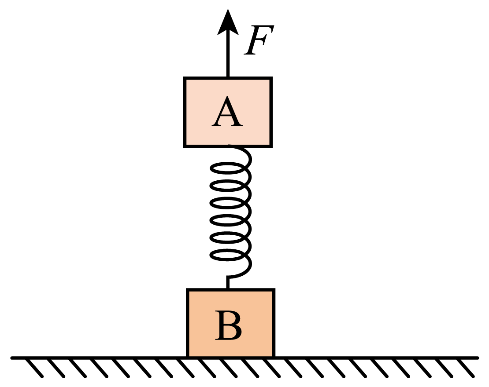

# Physics - 题目 327

**ID**: 6e45808692684409b9b9bcea0993d6d2
**年级**: Grade 10
**难度**: Medium-Hard
**题型**: Multiple-select

## 题目
如图所示，用一轻质弹簧把两块质量均为0.5kg的木块A、B连接起来，放在水平地面上，处于静止状态。​​​​​​​‌ $t=0$ 时，用竖直向上的力F作用在A上，使A向上做匀加速直线运动， $t=0.5{\rm{s}}$ 时B刚好离开地面。整个过程弹簧始终处于弹性限度内，劲度系数 $k=40{\rm{N}}{\rm{/}}{\rm{m}}$ ，重力加速度 $g=10{\rm{m}}{\rm{/}}{\rm{s}}{^{2}}$ ，不计空气阻力。 $0\sim 0.5{\rm{s}}$ 内，下列说法正确的是（      ）

## 解答

1. A．初始时刻弹簧的压缩量为 $x{{}_{1}}=\frac {mg}{k}=0.125{\rm{m}}=12.5{\rm{c}}{\rm{m}}$
2. $t=0.5{\rm{s}}$ 时B刚好离开地面，此时弹簧的伸长量为 $x{{}_{2}}=\frac {mg}{k}=0.125{\rm{m}}=12.5{\rm{c}}{\rm{m}}$
3. 则A上升的高度为 $h{{}_{{\rm{A}}}}=x{{}_{1}}+x{{}_{2}}=0.25{\rm{m}}=25{\rm{c}}{\rm{m}}$
4. 故A错误；
5. B．根据运动学公式 $h{{}_{{\rm{A}}}}=\frac {1}{2}at{^{2}}$
6. 解得A的加速度大小为 $a=2{\rm{m}}/{\rm{s}}{^{2}}$
7. 故B正确；
8. ${\rm CD．}t=0$ 时刻，力 $F$ 最小，为 $F{{}_{{\rm \min }}}=ma=1{\rm{N}}$
9. $t=0.5{\rm{s}}$ 时，力 $F$ 最大，由牛顿第二定律得 $F{{}_{{\rm \max }}}-mg-kx{{}_{2}}=ma$
10. 解得 $F{{}_{{\rm \max }}}=11{\rm{N}}$
11. 故C错误，D正确。
12. 故选BD。

## 知识点

**中文**:
  - 运动过程分析、多过程问题

**English**:
  - Analysis of Motion Process and Multi-process Problems

---
