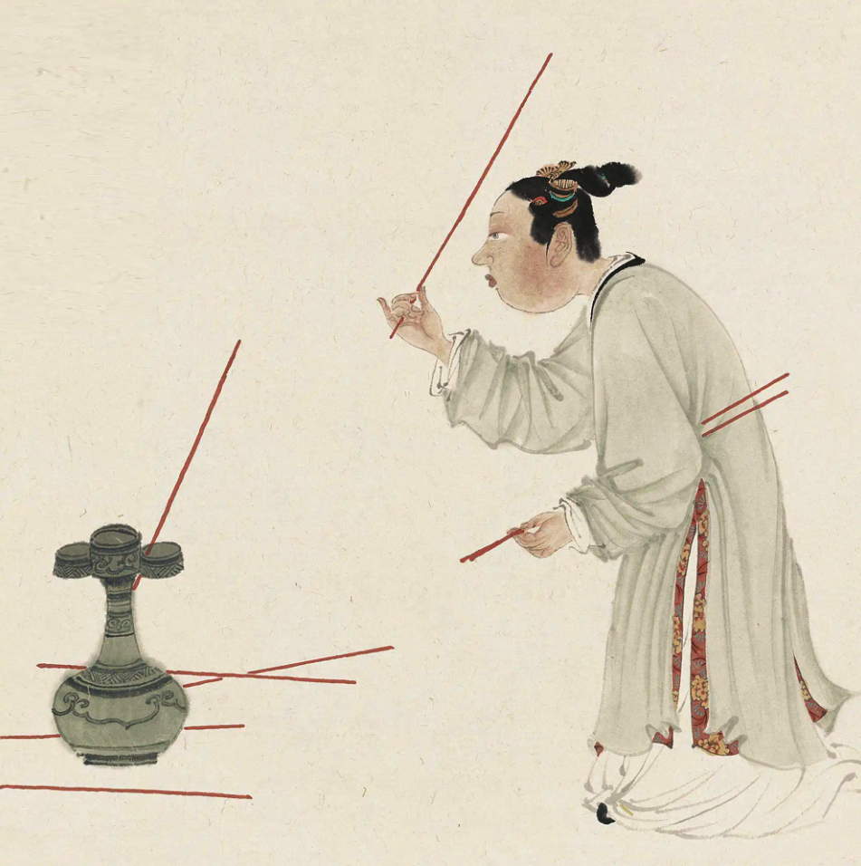

# Physics - 题目 899

**ID**: 6f3301f2741040a28a310a6b0ab74feb
**年级**: Grade 10
**难度**: Medium-Hard
**题型**: Multiple-select

## 题目
投壶是从先秦延续至清末的中国传统礼仪和宴饮游戏。​​​​​​​‌如图为古代民众进行投壶游戏的图片，游戏规则是游戏者需要在一定距离外把箭投进壶里。一次游戏中，游戏者将箭从距离地面1.8m的高度以 $v{{}_{0}}=8{\rm{m}}/{\rm{s}}$ 的初速度沿不同方向投出，不计空气阻力，箭视为质点，重力加速度g取10m/s²。下列说法正确的是（      ）

## 解答

1. 由机械能守恒 $mgh+\frac {1}{2}mv{{}_{0}^{2}}=\frac {1}{2}mv{^{2}}$ ，解得v=10m/s，选项A正确；初速度方向不确定，则无法确定速度变化量，选项B错误；若箭水平投出，竖直方向 $h=\frac {1}{2}gt{^{2}}$ ，水平方向 $x=v{{}_{0}}t$ ，代入数据解得 $x=4.8{\rm{m}}$ ，选项C正确；设初速度与水平方向的夹角为θ，则 $x=v{{}_{0}}{\cos}θt$ ， $y=-v{{}_{0}}\sin θt+\frac {1}{2}gt{^{2}}$ ，两式平方 $x{^{2}}=v{{}_{0}^{2}}{\cos}{^{2}}θt{^{2}}$ ， ${\left({\frac {1}{2}gt{^{2}}-y}\right)^{2}}=v{{}_{0}^{2}}\sin {^{2}}θt{^{2}}{\rm{\;}}$ ，两式相加 $x{^{2}}+{\left({y-\frac {1}{2}gt{^{2}}}\right)^{2}}=v{{}_{0}^{2}}t{^{2}}$ ，变形可得 $x{^{2}}=-\frac {g{^{2}}}{4}t{^{4}}+\left ({gy+v{{}_{0}^{2}}}\right )t{^{2}}-y{^{2}}$ ， $x{^{2}}=-\frac {g{^{2}}}{4}\left [t{^{4}}-\frac {4}{g{^{2}}}\left ({gy+v{{}_{0}^{2}}}\right )t{^{2}}\right ]-y{^{2}}$ ， $x{^{2}}=-\frac {g{^{2}}}{4}\left [t{^{2}}-\frac {2}{g{^{2}}}\left ({gy+v{{}_{0}^{2}}}\right )\right ]{^{2}}+\frac {g{^{2}}}{4}\cdot \frac {4}{g{^{4}}}{\left({gy+v{{}_{0}^{2}}}\right)^{2}}-y{^{2}}$ ，则 $x{{}_{{\rm{m}}{\rm{a}}{\rm{x}}}^{2}}=\frac {1}{g{^{2}}}{\left({gy+v{{}_{0}^{2}}}\right)^{2}}-y{^{2}}$ ，代入数据得 $x{{}_{{\rm{m}}{\rm{a}}{\rm{x}}}^{{{2}}}}=64{\rm ，\mathit{x}\mathit{_{max}}=8m}$ ，选项D正确。

## 知识点

**中文**:
  - 单一物体机械能守恒定律的应用
  - 平抛运动中的临界问题

**English**:
  - Applications for Single Body
  - Critical Problems in Horizontal Projectile Motion

---
