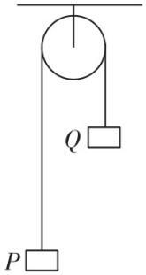

# Physics - 题目 1530

**ID**: 7058858e9ba2421ca38418f86464038e
**年级**: Grade 10
**难度**: Medium-Hard
**题型**: Multiple-select

## 题目
如图，轻质定滑轮固定在天花板上，物体 $P$ 和 $Q$ 用不可伸长的轻绳相连，悬挂在定滑轮上，质量 ${m}_{Q}>{m}_{P}$ , $t=0$ 时刻将两物体由静止释放，物体 $Q$ 的加速度大小为 $\frac{g}{3}$ .​​​​​​​‌ $T$ 时刻轻绳突然断开，物体 $P$ 能够达到的最高点恰与物体 $Q$ 释放位置处于同一高度，取 $t=0$ 时刻物体 $P$ 所在水平面为零势能面，此时物体 $Q$ 的机械能为 $E$ .重力加速度大小为 $g$ ，不计摩擦和空气阻力，两物体均可视为质点.下列说法正确的是（      ）

## 解答

1. 物体 $Q$ 的加速度大小为 $\frac{g}{3}$ ,则对系统由牛顿第二定律有 ${m}_{Q}g-{m}_{P}g=({m}_{P}+{m}_{Q})\frac{g}{3}$ ,解得 $\frac{{m}_{P}}{{m}_{Q}}=\frac{1}{2}$ , $\mathrm{A}$ 错误；设速度竖直向上为正方向,由题意作出物体 $P$ 、 $Q$ 运动的速度—时间图像,设 $t=0$ 时刻, $P$ 、 $Q$ 高度相差为 $H$ ,则可知 $H=\frac{1}{2}×\frac{4}{3}T×\frac{gT}{3}=\frac{2}{9}gT\hat{}2$ ,由题意可知 ${m}_{Q}gH=E$ ,则 ${m}_{Q}g=\frac{9E}{2g{T}^{2}}$ , ${m}_{P}g=\frac{9E}{4g{T}^{2}}$  , $t=2T$ 时刻,物体 $P$ 的速度 $v=\frac{g}{3}\cdot T-gT=-\frac{2gT}{3}$ ,即 $2T$ 时刻物体 $P$ 的速度大小为 $\frac{2gT}{3}$ , $\mathrm{D}$ 正确； $t=2T$ 时刻,物体 $P$ 重力的功率为 ${m}_{P}g\cdot \frac{2gT}{3}=\frac{3E}{2T}$ , $\mathrm{C}$ 正确；物体 $Q$ 在 $t=T$ 时刻的动能 ${E}_{\mathrm{k}}=\frac{1}{2}{m}_{Q}{v}_{Q}^{2}=\frac{1}{2}×\frac{9E}{2{g}^{2}{T}^{2}}×{\left(\frac{gT}{3}\right)^{2}}=\frac{1}{4}E$ ,此时物体 $P$ 上升距离为 $\frac{3}{4}H$ ,则物体 $Q$ 距离零势能面 $\frac{1}{4}H$ ,此时势能为 ${E}_{\mathrm{p}}=\frac{1}{4}E$ ,所以 $t=T$ 时刻,物体 $Q$ 的机械能为 ${E}_{\mathrm{k}}+{E}_{\mathrm{p}}=\frac{1}{2}E$ ,物体 $Q$ 在 $t=T$ 时刻之后只受重力作用,其机械能守恒,故 $\mathrm{B}$ 正确.
2. 

## 知识点

**中文**:
  - 其他连接体问题中机械能守恒定律的应用

**English**:
  - Other Connected Body Problems

---
