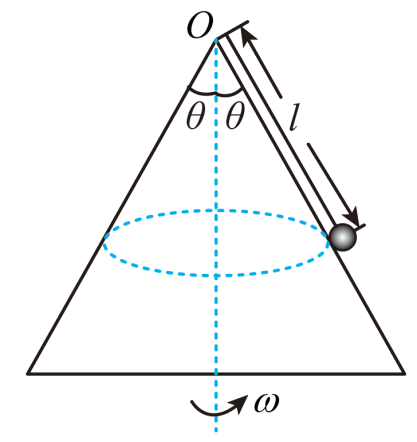

# Physics - 题目 829

**ID**: 733d2243179f480c8a2d6a9f8e8010e5
**年级**: Grade 10
**难度**: Medium-Hard
**题型**: Multiple-select

## 题目
如图所示，用一根长为l=1 m的细线，一端系一质量为m=1 kg的小球(可视为质点)，另一端固定在一光滑锥体顶端，锥面与竖直方向的夹角θ=30°，当小球在水平面内绕锥体的轴做匀速圆周运动的角速度为ω时，细线的张力为T，取g=10 m/s^{2}。​​​​​​​‌则下列说法正确的是（      ）

## 解答

1. 当小球对圆锥面恰好没有压力时，设角速度为 $ω{{}_{0}}$ ，则有 $T{\cos}θ=mg$ ， $T\sin θ=mω{{}_{0}^{2}}l\sin θ$ ，解得 $ω{{}_{0}}=2\sqrt {\frac {5\sqrt {3}}{3}}{\rm{r}}{\rm{a}}{\rm{d}}{\rm{/}}{\rm{s}}$ 。
2. AB：当 $ω=2{\rm{r}}{\rm{a}}{\rm{d}}{\rm{/}}{\rm{s}}{\rm{<}}ω{{}_{0}}$ ，小球紧贴圆锥面，则 $T{\cos}θ+N\sin θ=mg$ ， $T\sin θ-N{\cos}θ=mω{^{2}}l\sin θ$
3. 代入数据整理得 $T=(5\sqrt {3}+1){\rm{N}}{\rm ，A}$ 正确，B错误；
4. CD：当 $ω=4{\rm{r}}{\rm{a}}{\rm{d}}{\rm{/}}{\rm{s}}{\rm{>}}ω{{}_{0}}$ ，小球离开锥面，设绳子与竖直方向夹角为 $α$ ，则
5. $T{\cos}α=mg$ ， $T\sin α=mω{^{2}}l\sin α$ ，解得 $T=16{\rm{N}}$ ， $α={\arccos}\frac {5}{8}>45{^{{\rm{o}}}}{\rm ，C}$ 、D正确。选ACD。

## 知识点

**中文**:
  - 圆锥摆问题
  - 离心运动及其应用

**English**:
  - Conical Pendulum Problems
  - Centrifugal Motion and Applications

---
