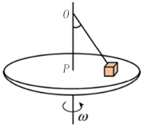

# Physics - 题目 2806

**ID**: 84702b7e5add4383980f1fdb3e499ccf
**年级**: Grade 10
**难度**: Medium-Hard
**题型**: Multiple-select

## 题目
如图所示，水平转台上有一个质量为m的小物块，用轻细绳将物块连接在通过转台中心的竖直转轴OP上，OP高度为h，物块距P点距离为R，系统静止时细绳伸直且拉力刚好为零。​​​​​​​‌物块与转台间动摩擦因数 $μ=0.5$ ，设最大静摩擦力等于滑动摩擦力。现物块和转台一起以相同的角速度绕OP轴做匀速圆周运动，重力加速度为g，下列说法错误的是（      ）

## 解答

1. A．若 $h=R$ ，系统静止时细绳伸直且拉力刚好为零，设最大静摩擦力等于滑动摩擦力时，转台的角速度为 $ω{{}_{0}}$ ，有 ${\rm }{\rm μm}g=mRω{{}_{0}^{2}}{\rm }$ ，解得 $ω{{}_{0}}=\sqrt {\frac {g}{2R}}$ ，当 $ω=\sqrt {\frac {g}{4R}}$ 时，明显 $ω<ω{{}_{0}}$ ，可知由静摩擦力提供向心力，竖直方向对物块受力分析有 $mg=N$ ，转台对物块的支持力等于重力；A错误，符合题意；
2. B．当物块刚好要要离开转台时，对转台的压力为零，设转台的角速度为 $ω{{}_{1}}$ ，此时物块受拉力和重力，由拉力和重力的合力提供向心力，有 $mg{\tan}θ=mRω{{}_{1}^{2}}$ ，由几何关系得 ${\tan}θ=\frac {R}{h}$ ，联立解得 $ω{{}_{1}}=\sqrt {\frac {g}{h}}$ ，若 $h=R$ ，当 $ω=\sqrt {\frac {3g}{4R}}$ ，明显 $ω{{}_{0}}<ω<ω{{}_{1}}$ ，得此时物块受拉力、支持力、摩擦力和重力，由拉力和摩擦力提供向心力 $T\sin θ+f=mRω{^{2}}$ ， $f=μ\left ({mg-T{\cos}θ}\right )$ ，解得 $f=\frac {1}{4}mg<\frac {1}{2}mg$ ，得摩擦力小于 $\frac {1}{2}mg{\rm ，B}$ 正确，不符合题意；
3. C．若 $h=R$ ，当 $ω=\sqrt {\frac {2g}{R}}$ ，明显 $ω>ω{{}_{1}}$ ，此时物块受拉力和重力，由拉力和重力的合力提供向心力，有 $F{{}_{向}}=mRω{^{2}}=2mg$ ，由几何关系可知 $T=\sqrt {F{{}_{向}^{2}}+（mg）{^{2}}}=\sqrt {5}mg{\rm ，C}$ 错误，符合题意；
4. D．当 $ω$ 较小 $ω<ω{{}_{0}}$ ，由静摩擦力提供向心力，随着 $ω$ 的增大，静摩擦力增大，当 $ω=ω{{}_{0}}$ ，静摩擦力达到最大静摩擦力时，静摩擦力达到最大值，随着 $ω$ 的增大，当 $ω=ω{{}_{1}}$ ，由拉力和重力的合力提供向心力，静摩擦力减小为零，所以随着 $ω$ 的取值由零逐增加，转台与物块的摩擦力先逐渐增加后逐渐减小，D正确，不符合题意；选AC。

## 知识点

**中文**:
  - 水平面内匀速圆周问题

**English**:
  - Uniform Circular Motion in Horizontal Plane

---
