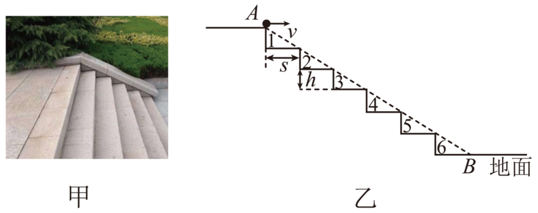

# Physics - 题目 2507

**ID**: a4b733a115bf42b5abe40ed82db1b406
**年级**: Grade 10
**难度**: Medium-Hard
**题型**: Multiple-select

## 题目
某公园的台阶如图甲所示，已知每级台阶的水平距离s=40cm，高度h=20cm。​​​​​​​‌台阶的侧视图如图乙所示，总共6级阶梯，虚线AB恰好通过每级台阶的顶点。某同学将一小球置于最上面台阶边缘的A点，并沿垂直于台阶边缘将其以初速度v水平抛出，空气阻力不计。每次与台阶或地面碰撞时，竖直方向的速度大小都变为原来的0.5倍，方向与原方向相反；水平方向的速度不变。下列说法正确的是（      ）

## 解答

1. 小球落到第1级台阶边缘时，初速度最大，竖直方向 $h=\frac {1}{2}gt{^{2}}$ ，水平方向 $s=vt$ ，联立解得 $v=2{\rm{m}}{\rm{/}}{\rm{s}}{\rm ，A}$ 错误；只要小球越过该虚线AB，则小球落到台阶上。设小球落到斜线上的时间 $t{{}_{1}}$ ，水平方向 $x=vt{{}_{1}}$ ，竖直方向 $y=\frac {1}{2}gt{{}_{1}^{2}}$ ，且 $\frac {x}{y}=\frac {40}{20}$ ，联立解得 $t{{}_{1}}{\rm =0.3s}$ ，相应的水平距离x=3×0.3m=0.9m，则台阶数 $n=\frac {0.9}{0.4}=2.25$ ，知小球抛出后首先落到的台阶为第3级台阶，B正确；当小球直接击中B点时，则有竖直方向 $6h=\frac {1}{2}gt{{}_{2}^{2}}$ ，水平方向 $6s=v{{}_{1}}t{{}_{2}}$ ，解得 $t{{}_{2}}=\frac {\sqrt {6}}{5}{\rm{s}}$ ， $v{{}_{1}}=2\sqrt {6}{\rm{m}}{\rm{/}}{\rm{s}}$ ，因为 $2\sqrt {6}{\rm{m}}{\rm{/}}{\rm{s}}{\rm{<}}7{\rm{m}}{\rm{/}}{\rm{s}}$ ，则v=7m/s时，小球直接落到地面上。落地时，竖直方向分速度为 $v{{}_{y1}}=gt{{}_{2}}=2\sqrt {6}{\rm{m}}{\rm{/}}{\rm{s}}$ ，每次地面碰撞时，竖直方向的速度大小都变为原来的0.5倍，从第一次碰撞到第二次碰撞，有 $\frac {1}{2}v{{}_{y1}}-(-\frac {1}{2}v{{}_{y1}})=gt{{}_{3}}$ ，解得 $t{{}_{3}}=\frac {\sqrt {6}}{5}{\rm{s}}$ ，从第二次碰撞到第三次碰撞，有 $\frac {1}{4}v{{}_{y1}}-(-\frac {1}{4}v{{}_{y1}})=gt{{}_{4}}$ ，解得 $t{{}_{4}}=\frac {\sqrt {6}}{10}{\rm{s}}$ ，总时间为 $t{{}_{总}}{\rm{=}}t{{}_{2}}{{+}}t{{}_{3}}{{+}}t{{}_{4}}=\frac {\sqrt {6}}{2}{\rm{s}}{\rm ，C}$ 正确；根据平抛运动规律可得，小球位移方向有 ${\tan}θ=\frac {Y}{X}=\frac {\frac {1}{2}gt{^{2}}}{v{{}_{0}}t}=\frac {gt}{2v{{}_{0}}}=\frac {v{{}_{y}}}{2v{{}_{0}}}$ ，多次抛出小球，使其恰好打在各级阶梯边缘，在小球每次的落点都在虚线AB上，则 ${\tan}θ$ 是固定值，则速度的方向 ${\tan}α=\frac {v{{}_{y}}}{v{{}_{0}}}=2{\tan}θ$ ，即多次抛出小球，使其恰好打在各级阶梯边缘，每次小球落点的速度方向相同，D正确。

## 知识点

**中文**:
  - 平抛运动中的临界问题

**English**:
  - Critical Problems in Horizontal Projectile Motion

---
