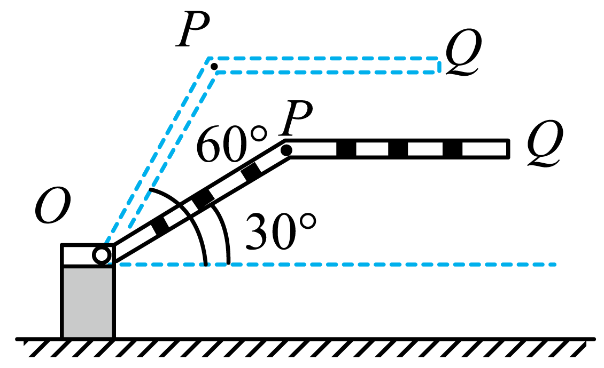

# Physics - 题目 529

**ID**: a6a90df79371404d9fbf9a964307ea46
**年级**: Grade 10
**难度**: Medium-Hard
**题型**: Multiple-select

## 题目
由于高度限制，车库出入口采用图所示的曲杆道闸，道闸由转动杆OP与横杆PQ链接而成，P、Q为横杆的两个端点。​​​​​​​‌在道闸抬起过程中，杆PQ始终保持水平。杆OP绕O点从与水平方向成30°匀速转动到60°的过程中，下列说法正确的是（      ）

## 解答

1. 由题知，杆OP绕O点从与水平方向成30°匀速转动到60°，则P点绕O点做匀速圆周运动，则P点的线速度、加速度大小不变，方向均改变，B错误；由图可知
2. 
3. 杆OP绕O点从与水平方向成30°匀速转动到60°，Q点相对于P点的位置不变，则Q点绕另一个圆心做匀速圆周运动，速度大小不变，水平方向的分量为 $v{{}_{x}}=v{{}_{Q}}{\cos}θ$ ，杆转动过程中，速度方向与水平方向的夹角不断减小，所以水平分速度不断增大，A正确；Q点在竖直方向的运动与P点相同，相对于O点在竖直方向的位置y关于时间t的关系为 $y=l{{}_{OP}}\sin (\frac {π}{6}+ωt)$ ，则可看出Q点在竖直方向不是匀速运动，C错误；由于杆PQ始终保持水平，P、Q两点总是保持相对静止，则P、Q两点的运动状态完全相同，二者线速度相同，由解析图可知，在相等时间内转过的弧长相等，弧长所对的圆心角相等，所以角速度相等，D正确。

## 知识点

**中文**:
  - 线速度、角速度和周期、转速

**English**:
  - Linear Velocity, Angular Velocity, Period, and Rotational Speed

---
