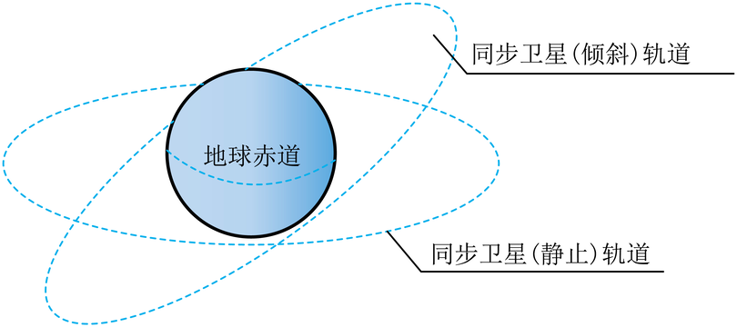

# Physics - 题目 126

**ID**: ac328a936d614dd4ada483b51f03ac29
**年级**: Grade 10
**难度**: Medium-Hard
**题型**: Multiple-select

## 题目
我国发射了世界上第一颗在同步轨道上运行的合成孔径雷达（SAR）卫星。​​​​​​​‌该卫星可用于监测城市建设、交通运输、海洋环境等人工活动。地球同步卫星包含静止轨道卫星和倾斜轨道卫星，关于地球同步卫星的说法正确的是（      ）

## 解答

1. 静止卫星位于赤道平面正上方，合肥不位于赤道上，静止卫星不可能在合肥的正上方，A错误；由于倾斜地球同步轨道卫星的周期和地球自转周期相等，地球赤道某一位置转过，该卫星也转过，该卫星又处于赤道上某位置上空，所以，倾斜轨道静止卫星一天2次经过赤道正上方同一位置，B正确；静止轨道卫星和倾斜轨道同步卫星的周期相等，根据万有引力提供向心力，则有 $\frac {GMm}{r{^{2}}}=mr\frac {4π{^{2}}}{T{^{2}}}$ ，可知它们的轨道半径相等，角速度大小相等，根据 $S=r{^{2}}ωt$ 可知，它们与地心的连线在相等时间内扫过的面积相等，C正确；根据 $\frac {GMm}{r{^{2}}}=m\frac {v{^{2}}}{r}$ ，可得 $v=\sqrt {\frac {GM}{r}}{\rm ，7.9km}$ /s是地球近地卫星的环绕速度，由于静止卫星的轨道半径要大于近地卫星的轨道半径，根据轨道半径越大环绕速度越小，因此静止卫星运行的线速度一定小于第一宇宙速度，D错误。

## 知识点

**中文**:
  - 近地卫星、同步卫星和赤道上随地球自转物体的分析比较

**English**:
  - Comparison: Near-Earth, Geostationary Satellites and Objects on Equator

---
