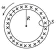

# Physics - 题目 663

**ID**: b003a03fbe9b4a72a662a153ab37896d
**年级**: Grade 10
**难度**: Medium-Hard
**题型**: Multiple-select

## 题目
半径为R的橡胶圆环均匀带正电，总电荷量为Q，现使圆环绕垂直环所在平面且通过圆心的轴以角速度ω匀速转动，则由环产生的等效电流判断正确的是（      ）​​​​​​​‌

## 解答

1. 截取圆环的任一截面S，如题图所示，在橡胶圆环运动一周的时间T内，通过这个截面的电荷量为Q，则有
2. I= $\frac {q}{t}=\frac {Q}{T}$
3. 又 $T=\frac {2{\rm{π}}}{ω}$ ，所以
4. I＝ $\frac {Qω}{2{\rm{π}}}$
5. A．由I＝ $\frac {Qω}{2{\rm{π}}}$ 可知，若ω不变而使电荷量Q变为原来的2倍，则电流也将变为原来的2倍，故A正确；
6. B．由I＝ $\frac {Qω}{2{\rm{π}}}$ 可知，电荷量Q不变而使ω变为原来的2倍，则电流也将变为原来的2倍，故B正确；
7. CD．由I＝ $\frac {Qω}{2{\rm{π}}}$ 可知，若使ω、Q不变，将橡胶环拉伸，使环的半径增大，对电流没有影响，故CD错误。
8. 故选AB。

## 知识点

**中文**:
  - 安培分子电流假说
  - 电流的形成、理解与微观表达式

**English**:
  - Ampere's Molecular Current Hypothesis
  - Formation, Understanding, and Microscopic Expression of Current

---
