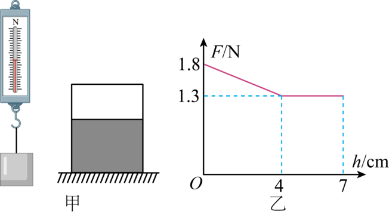

# Physics - 题目 1833

**ID**: b004e013d6844816b41c3d251e2389c7
**年级**: Grade 10
**难度**: Medium-Hard
**题型**: Multiple-select

## 题目
如图甲所示，弹簧测力计下悬挂着不吸水的圆柱体，圆柱体质量为 $180{\rm{g}}$ 。​​​​​​​‌不计厚度的平底容器置于水平桌面上，质量为 $100{\rm{g}}$ ，底面积为 $50{\rm{c}}{\rm{m}}{^{2}}$ ，高为 $8{\rm{c}}{\rm{m}}$ ，容器内盛有质量为 $350{\rm{g}}$ 的水。将圆柱体缓慢放入水中，圆柱体未接触容器，弹簧测力计示数 $F$ 随圆柱体下降高度 $h$ 的关系如图乙所示。下列说法不正确的是（      ）

## 解答

1. 观察乙图发现，圆柱体未浸入水中时，弹簧测力计示数为1.8N，则圆柱体重力为1.8N，圆柱体完全浸没在水中，弹簧测力计示数为1.3N，则圆柱体受到浮力 $F{{}_{浮}}=G-F{{}_{拉}}=1.8{\rm{N}}-1.3{\rm{N}}=0.5{\rm{N}}$ ，则圆柱体的体积 $V{{}_{柱}}=V{{}_{排}}=\frac {F{{}_{浮}}}{ρ{{}_{水}}g}=\frac {0.5{\rm{N}}}{1\times 10{^{3}}{\rm{k}}{\rm{g}}/{\rm{m}}{^{3}}\times 10{\rm{N}}/{\rm{k}}{\rm{g}}}=5\times 10{^{-5}}{\rm{m}}{^{3}}=50{\rm{c}}{\rm{m}}{^{3}}$ ，容器内盛有质量为350g的水，则水的体积 $V{{}_{水}}=\frac {m{{}_{水}}}{ρ{{}_{水}}}=\frac {350{\rm{g}}}{1{\rm{g}}/{\rm{c}}{\rm{m}}{^{3}}}=350{\rm{c}}{\rm{m}}{^{3}}$ ，容器底面积为 $50{\rm{c}}{\rm{m}}{^{2}}$ ，则容器中水的深度 $h{{}_{水}}=\frac {V{{}_{水}}}{S{{}_{容}}}=\frac {350{\rm{c}}{\rm{m}}{^{3}}}{50{\rm{c}}{\rm{m}}{^{2}}}=7{\rm{c}}{\rm{m}}$ ，圆柱体完全浸没在水中时，容器中水的深度 $h^{′}{{{}_{水}}}=\frac {V{{}_{水}}+V{{}_{柱}}}{S{{}_{容}}}=\frac {350{\rm{c}}{\rm{m}}{^{3}}+50{\rm{c}}{\rm{m}}{^{3}}}{50{\rm{c}}{\rm{m}}{^{2}}}=8{\rm{c}}{\rm{m}}$ ，则圆柱体完全浸没在水中时，水面上升高度 $Δh=h^{′}{{{}_{水}}}-h{{}_{水}}=8{\rm{c}}{\rm{m}}-7{\rm{c}}{\rm{m}}=1{\rm{c}}{\rm{m}}$ ，圆柱体下降4cm后，完全浸没在水中，则圆柱体的高度 $h{{}_{柱}}=h{{}_{降}}+Δh=4{\rm{c}}{\rm{m}}+1{\rm{c}}{\rm{m}}=5{\rm{c}}{\rm{m}}$ ，圆柱体的底面积 $S{{}_{柱}}=\frac {V{{}_{柱}}}{h{{}_{柱}}}=\frac {50{\rm{c}}{\rm{m}}{^{3}}}{5{\rm{c}}{\rm{m}}}=10{\rm{c}}{\rm{m}}{^{2}}{\rm ，A}$ 错误，B错误；圆柱体质量为180g，则圆柱体密度 $ρ{{}_{柱}}=\frac {m{{}_{柱}}}{V{{}_{柱}}}=\frac {180{\rm{g}}}{50{\rm{c}}{\rm{m}}{^{3}}}=3.6{\rm{g}}/{\rm{c}}{\rm{m}}{^{3}}=3.6\times 10{^{3}}{\rm{k}}{\rm{g}}/{\rm{m}}{^{3}}{\rm ，C}$ 正确；当 $h=4{\rm{c}}{\rm{m}}$ 时，圆柱体受到浮力为0.5N，由于力的作用是相互的，所以水受到向下的压力为0.5N，容器对水平桌面的压强 $p=\frac {G{{}_{容}}+G{{}_{水}}+F{{}_{压}}}{S{{}_{容}}}=\frac {m{{}_{容}}g+m{{}_{水}}g+F{{}_{压}}}{S{{}_{容}}}=\frac {0.1{\rm{k}}{\rm{g}}\times 10{\rm{N}}/{\rm{k}}{\rm{g}}+0.35{\rm{k}}{\rm{g}}\times 10{\rm{N}}/{\rm{k}}{\rm{g}}+0.5{\rm{N}}}{50\times 10{^{-4}}{\rm{m}}{^{2}}}=1000{\rm{P}}{\rm{a}}{\rm ，D}$ 错误。

## 知识点

**中文**:
  - 力学

**English**:
  - Mechanics

---
