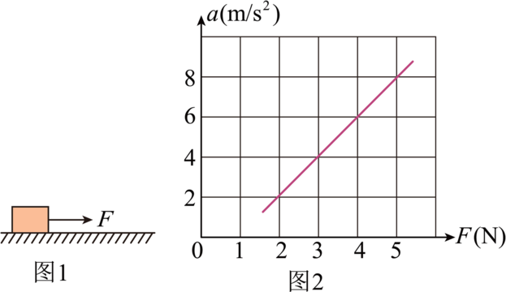

# Physics - 题目 1620

**ID**: bf6b6faad16642d583f593a9808a0769
**年级**: Grade 10
**难度**: Medium-Hard
**题型**: Multiple-select

## 题目
图1表示用水平恒力F拉动水平面上的物体，使其做匀加速直线运动。​​​​​​​‌当改变拉力的大小时，相对应的匀加速直线运动的加速度a也会变化，a和F的关系如图2所示（重力加速度取10m/s^{2}）。则（      ）

## 解答

1. AB．根据图2可知，取图2中F_{1}=3N和F_{2}=5N的两点，对应加速度为a_{1}=4m/s^{2}和a_{2}=8 m/s^{2}，根据牛顿第二定律可知：
2. $F{{}_{1}}-f=ma{{}_{1}}$
3. $F{{}_{2}}-f=ma{{}_{2}}$
4. 代入数据联立解得：m=0.5kg，f=1N；故A正确，B错误.
5. C．根据滑动摩擦力公式有;
6. $f={\rm μm}g$
7. 代入数据解得μ=0.2，故C正确.
8. D．由牛顿第二定律可知：
9. $F-f=ma$
10. 所以：
11. $a=\frac {F}{m}-\frac {f}{m}$
12. 由数学知识可知图像的斜率：
13. $k=\frac {1}{m}$
14. 故该物体上放一个与该物体质量相同的砝码，保持砝码与该物体相对静止，相当于质量增加，所以斜率减小，故D错误.
15. 故选AC.

## 知识点

**中文**:
  - 牛顿第二定律的简单计算

**English**:
  - Simple Calculations of Newton's 2nd Law

---
