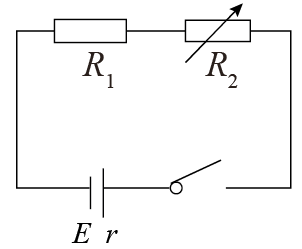

# Physics - 题目 827

**ID**: c0474d14aaed4e1a8fd5154f12145570
**年级**: Grade 10
**难度**: Medium-Hard
**题型**: Multiple-select

## 题目
如图所示， $R{{}_{1}}$ 为定值电阻， $R{{}_{2}}$ 为可变电阻，E为电源的电动势，r为电源的内阻，以下说法正确的是（      ）​​​​​​​‌

## 解答

1. A．将 $R{{}_{1}}$ 也看成电源的内阻， $R{{}_{2}}$ 上的功率等于电源的输出功率，当外电阻等于内阻时，即
2. $R{{}_{2}}=R{{}_{1}}+r$
3. 时输出功率最大，即 $R{{}_{2}}$ 上的功率最大，故A正确；
4. B．由于 $R{{}_{1}}$ 的阻值不变，根据 $P=I{^{2}}R$ ，电流最大时， $R{{}_{1}}$ 上的功率最大，当外电阻最小时，即 $R{{}_{2}}=0$ 时，电流最大， $R{{}_{1}}$ 上的功率最大，故B错误；
5. C．电源的效率
6. $η=\frac {UI}{EI}\times 100\%{\rm{=}}\frac {R{{}_{1}}+R{{}_{2}}}{R{{}_{1}}+R{{}_{2}}+r}\times 100\%$
7. 当 $R{{}_{2}}$ 增大时，电源的效率增大，故C正确；
8. D．当外电阻等于内阻时，电源的输出功率最大，外电阻与内电阻越接近，电源的输出功率越大，由于 $R{{}_{1}}$ 与r的关系未知，故当 $R{{}_{2}}=0$ 时，电源的输出功率不一定最小，故D错误。
9. 故选AC。

## 知识点

**中文**:
  - 闭合电路输出功率与效率

**English**:
  - Output Power and Efficiency of Closed Circuits

---
