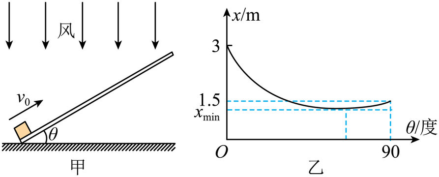

# Physics - 题目 1633

**ID**: cf945dd27e3d4ba4a2daf5030de9c9c4
**年级**: Grade 10
**难度**: Medium-Hard
**题型**: Multiple-select

## 题目
风洞是研究空气动力学的实验设备。​​​​​​​‌如图甲，装置放置于风洞中，一物块每次以相同的初速率 $v{{}_{0}}$ 沿斜面向上运动，风洞给物块提供竖直向下的恒力 $F=2.0{\rm{N}}$ 。改变斜面倾角 $θ$ ，物块冲上斜面的最大距离 $x$ 与 $θ$ 的关系如图乙所示，已知物块质量 $m=1.0{\rm{k}}{\rm{g}}$ ，取 $\sin 37\mathrm{°}=0.6$ ，重力加速度大小 $g=10{\rm{m}}/{\rm{s}}{^{2}}$ ，则（      ）

## 解答

1. 由图乙可知当 $θ=0$ 时， $x{{}_{1}}=3{\rm{m}}$ ，根据动能定理可得 $-μ(mg+F)x{{}_{1}}=0-\frac {1}{2}mv{{}_{0}^{2}}$ ，当 $θ=90{}\degree $ 时， $x{{}_{2}}=1.5{\rm{m}}$ ，根据动能定理可得 $-(mg+F)x{{}_{2}}=0-\frac {1}{2}mv{{}_{0}^{2}}$ ，联立解得 $v{{}_{0}}=6{\rm{m}}/{\rm{s}}$ ， $μ=0.5{\rm ，A}$ 正确，B错误；以物块为对象，根据牛顿第二定律可得 $(mg+F)\sin θ+μ(mg+F){\cos}θ=ma$ ，可得加速度大小为 $a=12\sin θ+6{\cos}θ$ ，根据数学知识可知，加速度的最大值为 $a{{}_{{\rm{m}}}}=\sqrt {12{^{2}}+6{^{2}}}=6\sqrt {5}{\rm{m}}/{\rm{s}}$ ，则图乙中 $x$ 的最小值为 $x{{}_{{\rm{m}}{\rm{i}}{\rm{n}}}}=\frac {v{{}_{0}^{2}}}{2a{{}_{{\rm{m}}}}}=\frac {3\sqrt {5}}{5}{\rm{m}}{\rm ，C}$ 错误；当 $θ=37{}\degree $ 时，可得物块的加速度大小为 $a=12\sin 37{}\degree +6{\cos}37{}\degree =12{\rm{m}}/{\rm{s}}{^{2}}$ ，物块上滑的位移大小为 $x=\frac {v{{}_{0}^{2}}}{2a}{\rm{m}}=1.5{\rm{m}}$ ，则物块向上运动过程中与斜面摩擦产生的热量为 $Q=μ(mg+F){\cos}37{}\degree \cdot x=7.2{\rm{J}}{\rm ，D}$ 正确。

## 知识点

**中文**:
  - 应用动能定理求解与图像相关的动能问题

**English**:
  - Graph-related Kinetic Energy Problems

---
