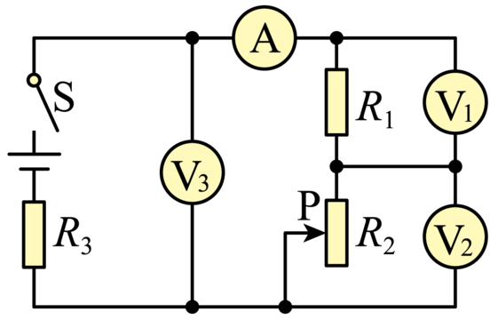

# Physics - 题目 59

**ID**: d3c54f225dcb4e9ca8964ee530fd7c1a
**年级**: Grade 10
**难度**: Medium-Hard
**题型**: Multiple-select

## 题目
在如图所示电路中，闭合电键S，当滑动变阻器的滑动触头P向上滑动时，四个理想电表的示数都发生变化，电表的示数分别用I、 $U{{}_{1}}$ 、 $U{{}_{2}}$ 和 $U{{}_{3}}$ 表示，电表示数变化量的绝对值分别用 $ΔI$ 、 $\Delta U{{}_{1}}$ 、 $\Delta U{{}_{2}}$ 和 $\Delta U{{}_{3}}$ 表示，下列说法正确的是  $($        $)$​​​​​​​‌

## 解答

1. AB.闭合电键S，当滑动变阻器的滑动触头P向上滑动时，滑动变阻器的电阻R_{2}减小，由于 $R{{}_{1}}$ 、 $R{{}_{2}}$ 和 $R{{}_{3}}$ 串联，则总电阻减小，由闭合电路的欧姆定律得总电流为：
2. $I=\frac {E}{r+R{{}_{1}}+R{{}_{2}}+R{{}_{3}}}$ ，
3. 则总电流增大，由路端电压公式：
4. $U{{}_{3}}=E-I\left ({r+R{{}_{3}}}\right )$
5. 知， $U{{}_{3}}$ 减小，由欧姆定律知电阻 $R{{}_{1}}$ 两端的电压为：
6. $U{{}_{1}}=IR{{}_{1}}$ ，
7. 则 $U{{}_{1}}$ 增大，由串并联关系知
8. $U{{}_{3}}=U{{}_{1}}+U{{}_{2}}$ ，
9. 则 $U{{}_{2}}$ 减小，故AB错误；
10. CD.因 $R{{}_{1}}$ 不变，则由欧姆定律可得，
11. $\frac {U{{}_{1}}}{I}=R{{}_{1}}$
12. 保持不变，由数学规律可知， $\frac {ΔU{{}_{1}}}{ΔI}$ 也保持不变，因滑片向上移动，故 $R{{}_{2}}$ 的接入电阻减小，故 $\frac {U{{}_{2}}}{I}$ 变小，而
13. $\frac {ΔU{{}_{2}}}{ΔI}=\frac {ΔI\left ({R{{}_{1}}+R{{}_{3}}+r}\right )}{Δl}=R{{}_{1}}+r+R{{}_{3}}$ ，
14. 故 $\frac {\Delta U{{}_{2}}}{\Delta I}$ 保持不变，因
15. $\frac {U{{}_{3}}}{I}=R{{}_{1}}+R{{}_{2}}$ ，
16. 故比值减小，而
17. $\frac {ΔU{{}_{3}}}{ΔI}=\frac {ΔI\left ({r+R{{}_{3}}}\right )}{ΔI}=r+R{{}_{3}}$ ，
18. 故比值保持不变，故CD正确；
19. 故选CD；

## 知识点

**中文**:
  - 电路的动态分析问题

**English**:
  - Dynamic Circuit Analysis

---
