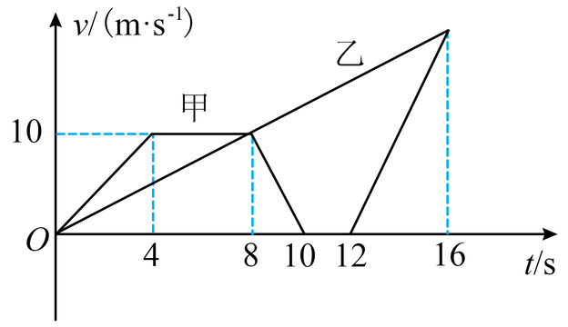

# Physics - 题目 2202

**ID**: ece7bfae6f34401080a1eaf48bd4315e
**年级**: Grade 10
**难度**: Medium-Hard
**题型**: Multiple-select

## 题目
随着自动驾驶技术不断成熟，北京、上海等城市某些特定地区相继出现无人驾驶网约车，给市民出行带来方便。​​​​​​​‌如图所示是两辆无人驾驶汽车在某一水平直线道路上同时同地出发运动的v—t图像，其中乙车为匀加速直线运动，甲车经匀加、匀速、匀减、静止、匀加等运动过程，两车能安全错车，均可看做质点，对两车在0~16s的运动过程，下列说法正确的是（      ）

## 解答

1. A．v—t图像中，图像与时间轴所围几何图形的面积表示位移，根据图像可知，8s内甲车的位移大于乙车的位移，即乙车经8s没有追上甲车，A错误；
2. B．乙车的加速度 $a=\frac {10}{8}{\rm{m}}{\rm{/}}{\rm{s}}{^{2}}=\frac {5}{4}{\rm{m}}{\rm{/}}{\rm{s}}{^{2}}$ ，乙12s时的速度 $v{{}_{1}}=at{{}_{1}}=\frac {5}{4}\times 12{\rm{m}}{\rm{/}}{\rm{s}}=15{\rm{m}}{\rm{/}}{\rm{s}}{\rm ，12s}$ 内乙的位移 $x{{}_{1}}=\frac {v{{}_{1}}}{2}t{{}_{1}}=90{\rm{m}}$ ，乙10s时的速度 $v{{}_{2}}=at{{}_{2}}=\frac {5}{4}\times 10{\rm{m}}{\rm{/}}{\rm{s}}=12.5{\rm{m}}{\rm{/}}{\rm{s}}{\rm ，10s}$ 内乙的位移 $x{{}_{2}}=\frac {v{{}_{2}}}{2}t{{}_{2}}=62.5{\rm{m}}{\rm ，12s}$ 内甲的位移与10s内的位移相等，大小均为 $x{{}_{3}}=\frac {\left ({8-4+10}\right )\times 10}{2}{\rm{m}}=70{\rm{m}}$ ，由于 $x{{}_{2}}<x{{}_{3}}<x{{}_{1}}$ ，表明两车相遇时刻在10s与12s之间的某时刻，令为 $t{{}_{3}}$ ，则有 $x{{}_{3}}=\frac {1}{2}at{{}_{3}^{2}}$ ，结合上述解得 $t{{}_{3}}=4\sqrt {7}{\rm{s}}$ ，即乙车经 $4\sqrt {7}{\rm{s}}$ 追上甲车，B正确；
3. C.乙车追上甲车前，当两者速度相等，即8s时刻的10m/s时，两车相距最远，由于v—t图像中，图像与时间轴所围几何图形的面积表示位移，根据图像可知，最远距离为 $x{{}_{{\rm \max }}}{{}_{1}}=\frac {\left ({8-4}\right )\times 10}{2}{\rm{m}}=20{\rm{m}}$ ，则乙车追上甲车前两车最远相距20m，C正确；
4. D.由图可知， $t=16s$ 时，甲，乙两车第二次速度最大，乙车在甲车前方，此时乙车追上甲车后两车有最远距离，最远距离为 $x{{}_{{\rm \max }2}}=\frac {1}{2}\times \frac {5}{4}\times 16{^{2}}{\rm{m}}-\frac {(8-4)+10}{2}\times 10{\rm{m}}-\frac {16-12}{2}\times \frac {5}{4}\times 16{\rm{m}}{\rm{=}}{{5}}{{0}}{\rm{m}}$ ，则乙车追上甲车后两车最远相距50m，D正确。选BCD。

## 知识点

**中文**:
  - v-t图像及其应用

**English**:
  - v-t Graphs and Applications

---
