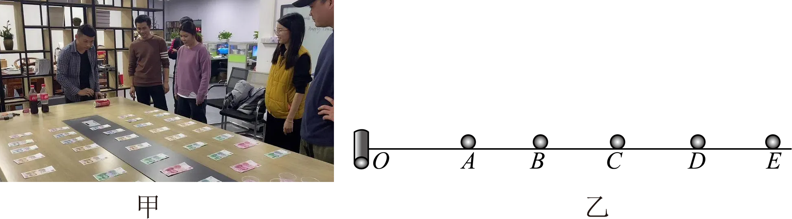

# Physics - 题目 2696

**ID**: f67eecbfca304cde92ba6deaf61540d6
**年级**: Grade 10
**难度**: Medium-Hard
**题型**: Multiple-select

## 题目
春节临近，有长辈给小朋友压岁钱的习俗，为了增添年味，现在发压岁钱的方式也是越来越有趣，其中有一种叫做“滚钱”，具体操作是在桌面放置不同金额的纸币，瓶子滚到哪张纸币上就可以赢取此金额，如图甲所示。​​​​​​​‌为了便于分析，我们用图乙来描述这个模型，滚瓶从水平桌面上O点出发，途中经过A、B、C、D、E5个放钱的位置，相邻两个位置的距离均为0.2m，滚瓶停在哪里就获得对应的压岁钱，滚瓶掉下桌子就没有。现设滚瓶（可视为质点）从O点出发后匀减速直线运动，张强同学以 $v{{}_{0}}=1{\rm{m}}/{\rm{s}}$ 的速度推出滚瓶，最后刚好停在E处，已知滚瓶在D点和E点之间滑行的时间为1s，则下列说法正确的是（      ）

## 解答

1. A．滚瓶做末速度为零的匀减速运动，设滚瓶依次滑过两相邻位置的时间间隔分别为 $t{{}_{1}}$ 、 $t{{}_{2}}$ 、 $t{{}_{3}}$ 和 $t{{}_{4}}$ ，由逆向思维可知每段所用的时间之比为 $t{{}_{4}}:t{{}_{3}}:t{{}_{2}}:t{{}_{1}}=1:(\sqrt {2}-1):(\sqrt {3}-\sqrt {2}):(2-\sqrt {3})$ ，而 $t{{}_{4}}=1{\rm{s}}$ ，所以滚瓶由位置A滑至位置E所用的时间为 $t=t{{}_{4}}+t{{}_{3}}+t{{}_{2}}+t{{}_{1}}=2{\rm{s}}{\rm ，A}$ 正确；
2. B．滚瓶由位置D到位置E，根据位移-时间公式 $x=\frac {1}{2}at{{}_{4}^{2}}$ ，可得 $a=0.4{\rm{m}}/{\rm{s}}{^{2}}$ ，滚瓶经过位置A的速度 $v{{}_{2}}=at=0.8{\rm{m}}/{\rm{s}}$ ，滚瓶经过位置B的速度 $v{{}_{2}}=v{{}_{1}}-at{{}_{1}}=0.8{\rm{m}}/{\rm{s}}-0.4\times (2-\sqrt {3}){\rm{m}}/{\rm{s}}=0.4\sqrt {3}{\rm{m}}/{\rm{s}}$ ，在OB之间的平均速度 ${\overline{v{{}_{OB}}}}=\frac {v{{}_{0}}+v{{}_{2}}}{2}=\frac {1+0.4\sqrt {3}}{2}{\rm{m}}/{\rm{s}}\ne v{{}_{1}}=0.8{\rm{m}}/{\rm{s}}{\rm ，B}$ 错误；
3. C．根据速度时间公式可得滚瓶经过位置D的速度 $v{{}_{4}}=at{{}_{4}}=0.4{\rm{m}}/{\rm{s}}=\frac {1}{2}v{{}_{1}}{\rm ，C}$ 错误；
4. D．滚瓶从O点到位置E，根据速度-位移公式，有 $x{{}_{OE}}=\frac {v{{}_{0}^{2}}}{2a}=\frac {5}{4}{\rm{m}}$ ，则若以0.9m/s的速度将滚瓶推出，滚瓶运动的位移为 $x^{′}=\frac {v^{′}{{{}_{0}^{2}}}}{2a}=\frac {81}{80}{\rm{m}}<x{{}_{OD}}=x{{}_{OE}}-0.2{\rm{m}}=1.05{\rm{m}}$ ，且 $x^{′}>x{{}_{CC}}=x{{}_{OE}}-0.2\times 2{\rm{m}}=0.85{\rm{m}}$ ，停在CD之间，D正确。选AD。

## 知识点

**中文**:
  - 匀变速直线运动重要推论的应用
  - 逆向思维法在匀变速直线运动中的应用

**English**:
  - Applications of Important UVRM Corollaries
  - Reverse Thinking in UVRM Problems

---
