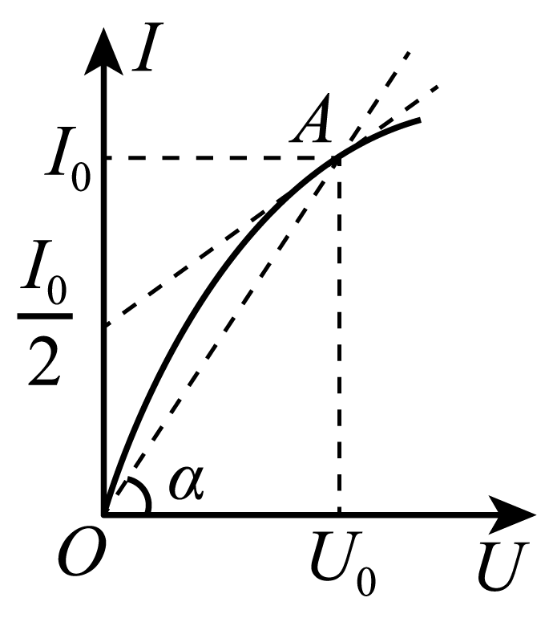

# Physics - 题目 295

**ID**: ffe4a32dc2d140d8ae34a04b17bbbcb3
**年级**: Grade 10
**难度**: Medium-Hard
**题型**: Multiple-select

## 题目
假设某同学研究白炽灯得到某白炽灯的伏安特性曲线如图所示。​​​​​​​‌图像上A点与原点的连线与横轴成α角，则（      ）

## 解答

1. A．不能通过测量出α角的大小，来求解电阻值，因横纵坐标的标度发生变化，角度α可能会变化，但是电阻值不变，也就是角度α的值与标度有关，而电阻值与标度无关，A错误；
2. C．由图可知在A点，白炽灯两端得电压为U_{0}，流过白炽灯的电流为I_{0}，根据功率公式，可得白炽灯的电功率可表示为
3. $P=U{{}_{0}}I{{}_{0}}$
4. C正确；
5. BD．由图可知在A点，白炽灯两端得电压为U_{0}，流过白炽灯的电流为I_{0}，根据欧姆定律，可知白炽灯的电阻
6. $R=\frac {U{{}_{0}}}{I{{}_{0}}}$
7. 不能根据
8. $R=\frac {U{{}_{0}}}{I{{}_{0}}-\frac {1}{2}I{{}_{0}}}$
9. 求电阻，B错误D正确。
10. 故选CD。

## 知识点

**中文**:
  - 常见的电路元器件

**English**:
  - Common Circuit Components

---
