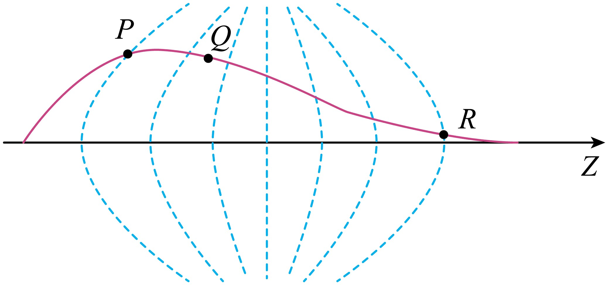

# Physics - 题目 2750

**ID**: 0dfa5dc97e764642a21e15402ac848ab
**年级**: Grade 10
**难度**: Medium
**题型**: Multiple-choice

## 题目
2024年12月，由生物岛实验室领衔研制、我国首个拥有自主知识产权的国产商业场发射透射电镜TH-F120完成了首批订单合同签订，正式开启了国产透射电镜的市场应用。​​​​​​​‌其中一种电子透镜的电场分布如图所示，虚线为等势面，相邻等势面间电势差相等，z轴为该电场的中心轴线。一电子从其左侧进入聚焦电场，实线为电子运动的轨迹，P、Q、R为其轨迹上的三点，电子仅在电场力的作用下从P点运动到R点，在此过程中，下列说法正确的是（      ）

## 解答

1. 电子在P点的受力方向与等势面垂直，电子做曲线运动受力方向指向轨迹的凹侧，所以电子在P点的受力方向斜向右下，A错误；等差等势线越密，电场强度越大，所以P点场强大于R点场强，则电子在P点受到的电场力大，根据牛顿第二定律可知，电子在P点的加速度大于在R点的加速度，B错误；电子受电场力方向与电场强度方向相反，所以电场强度方向背离PQ实线方向，根据电场线与等势面垂直，且由电势高的地方指向电势低的地方，则从P到R的电势升高，根据公式 $E{{}_{{\rm p}}}=qφ$ 可知，电子电势能减小，动能增大，速度大小一直增大，D正确，C错误。

## 知识点

**中文**:
  - 电势能与静电力做功

**English**:
  - Electric Potential Energy and Work Done by Electrostatic Force

---
