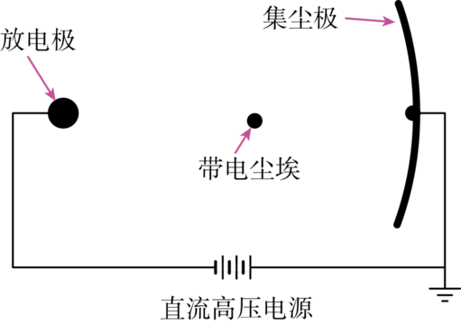

# Physics - 题目 192

**ID**: 1114911e7d6b4f49b4bf47c8b9e0c0a7
**年级**: Grade 10
**难度**: Medium
**题型**: Multiple-choice

## 题目
如图，为静电除尘器除尘机理的示意图．尘埃在电场中通过某种机制带电，在电场力的作用下向集尘极迁移并沉积，以达到除尘目的，下列表述正确的是（      ）​​​​​​​‌

## 解答

1. ABC．由图示可知，集尘极与直流高压电源正极相连，则电场方向由集尘板指向放电极，尘埃在电场中通过某种机制带电，在电场力的作用下向集尘极迁移并沉积，则尘埃的电场力方向向右，故到达到达集尘极的尘埃带负电荷，故ABC错误；
2. D．根据
3. $F=Eq$
4. 可知，同一位置带电荷量越多场强越大，尘埃所受电场力越大，故D正确。
5. 故选D。

## 知识点

**中文**:
  - 尖端放电、静电屏蔽与静电吸附

**English**:
  - Point Discharge, Electrostatic Shielding, and Adsorption

---
