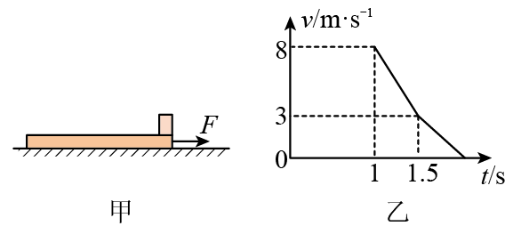

# Physics - 题目 2033

**ID**: 2e74d0f19b04415b930253cb593f6dba
**年级**: Grade 10
**难度**: Medium
**题型**: Multiple-choice

## 题目
如图甲，足够长木板静置于水平地面上，木板右端放置一小物块。​​​​​​​‌在t=0时刻对木板施加一水平向右的恒定拉力F，作用1s后撤去F，此后木板运动的v—t图像如图乙。物块和木板的质量均为1kg，物块与木板间及木板与地面间均有摩擦，最大静摩擦力等于滑动摩擦力，重力加速度g=10m／s^{2}，下列说法正确的是（      ）

## 解答

1. 由图像可知，撤去拉力F前，物块在木板上一直有有相对运动，否则，撤去拉力F后，木板的v-t图像不可能是两段折线。在1～1.5s内，物块加速、木板减速，设它们的加速度大小分别为a_{1}、a_{2}，则 $a{{}_{1}}=\frac {Δv{{}_{1}}}{Δt{{}_{1}}}=\frac {3-0}{1.5-0}{\rm{m}}{\rm{/}}{\rm{s}}{^{2}}=2{\rm{m}}{\rm{/}}{\rm{s}}{^{2}}$ ， $a{{}_{2}}=\frac {Δv{{}_{2}}}{Δt{{}_{2}}}=\frac {8-3}{1.5-1}{\rm{m}}{\rm{/}}{\rm{s}}{^{2}}=10{\rm{m}}{\rm{/}}{\rm{s}}{^{2}}$ ，设物块、木板的质量均为m，物块与木板之间的动摩擦因数为μ_{1}，木板与地面之间的动摩擦因数μ_{2}，则有对物块 $μ{{}_{1}}mg=ma{{}_{1}}$ ， $μ{{}_{1}}mg+μ{{}_{2}}\cdot 2mg=ma{{}_{2}}$ ，得μ_{1}=0.2，μ_{2}=0.4，撤去拉力F前，木板的加速度 $a{{}_{0}}=\frac {Δv}{Δt}=8{\rm{m}}{\rm{/}}{\rm{s}}{^{2}}$ ，对木板,根据第二定律有 $F-(μ{{}_{1}}mg+μ{{}_{2}}\cdot 2mg)=ma{{}_{0}}$ ，得F=18N，选项A错误；由上可知，物块与木板间的动摩擦因数为 $μ{{}_{1}}{\rm{=}}0{{.}}{{2}}$ ，选项B错误；在t_{1}=1.5s内，物块位移为 $x{{}_{1}}=\frac {v{{}_{1}^{2}}}{2a{{}_{1}}}=\frac {3{^{2}}}{2\times 2}{\rm{m}}=2.25{\rm{m}}$ ，木板位移为 $x{{}_{2}}=\frac {v}{2}t+\frac {v{^{2}}-v{{}_{1}^{2}}}{2a{{}_{2}}}=(\frac {8}{2}\times 1+\frac {8{^{2}}-3{^{2}}}{2\times 10}){\rm{m}}=6.75{\rm{m}}$ ，在t_{1}=1.5s后，物块与木板间仍有相对滑动，物块的加速度大小 $a{{}_{1}}{^{\prime }}=μ{{}_{1}}g=2{\rm{m}}{\rm{/}}{\rm{s}}{^{2}}$ ，木板的加速度大小为 $a{{}_{2}}{^{\prime }}$ ， $μ{{}_{2}}\cdot 2mg-μ{{}_{1}}mg=ma{{}_{2}}{^{\prime }}$ ，得 $a{{}_{2}}{^{\prime }}=6{\rm{m}}{\rm{/}}{\rm{s}}{^{2}}$ ，物块到停止的时间还需 $t{{}_{块}}{\rm{=}}\frac {v{{}_{1}}}{a{{}_{1}}{^{\prime }}}=\frac {3}{2}{\rm{s}}=1.5{\rm{s}}$ ，木板到停止的时间还需 $t{{}_{板}}{\rm{=}}\frac {v{{}_{1}}}{a{{}_{2}}{^{\prime }}}=\frac {3}{6}{\rm{s}}=0.5{\rm{s}}$ ，所以木板比物块早停止运动。在t_{1}=1.5s到物块停止运动的时间内，物块的位移为 $x{{}_{1}}{^{\prime }}=\frac {v{{}_{1}^{2}}}{2a{{}_{1}}{^{\prime }}}=\frac {3{^{2}}}{2\times 2}{\rm{m}}=2.25{\rm{m}}$ ，木板位移为 $x{{}_{2}}{^{\prime }}=\frac {v{{}_{1}^{2}}}{2a{{}_{2}}{^{\prime }}}=\frac {3{^{2}}}{2\times 6}{\rm{m}}=0.75{\rm{m}}$ ，物块最终停止时的位置与木板右端间的距离为 $Δs=x{{}_{2}}+x{{}_{2}}{^{\prime }}-(x{{}_{1}}+x{{}_{1}}{^{\prime }})=[6.75+0.75-(2.25+2.25)]{\rm{m}}=3{\rm{m}}$ ，选项C正确；由上可知，物块从开始到停止运动的时间为3s，2s时的速度不为0，选项D错误。

## 知识点

**中文**:
  - 板块模型

**English**:
  - Plate Model

---
