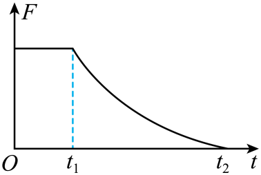

# Physics - 题目 2701

**ID**: 3fd9d144618f4b5882c964b24534140e
**年级**: Grade 10
**难度**: Medium
**题型**: Multiple-choice

## 题目
列车在平直轨道上由静止开始启动，启动过程受到的合外力F随时间 $t$ 变化的关系图像如图所示，列车达到额定功率后保持该功率不变，若列车所受阻力恒定，则（      ）​​​​​​​‌

## 解答

1. A．根据 $P{{}_{牵}}=F{{}_{牵}}v=（F+f）v$  $0\sim t{{}_{1}}$ 时间内，列车的功率在随速度均匀增大，在 $t{{}_{1}}$ 时刻速度达到最大，即达到额定功率，A错误；
2. B．根据牛顿第二定律 $F=ma$ ，即在 $0\sim t{{}_{1}}$ 时间内，列车的加速度不变，则列车的功率为 $P{{}_{牵}}=（F+f）v=（F+f）at$ ，所以，列车的功率随时间均匀增大，B错误；
3. C．根据 $P{{}_{阻}}=fv$ ， $P{{}_{合}}=P{{}_{牵}}-P{{}_{阻}}$ ，因为在 $t{{}_{1}}\sim t{{}_{2}}$ 时间内，列车的功率为额定功率且不变，则 $P{{}_{合}}=P{{}_{额}}-P{{}_{阻}}=P{{}_{额}}-fv$ ，在 $t{{}_{1}}\sim t{{}_{2}}$ 时间内，列车的合力的功率随速率均匀减小，C正确；
4. D．根据 $a=\frac {F}{m}$ ，可知，列车的加速度变化与合外力的变化相同，即在 $0\sim t{{}_{2}}$ 时间内，列车先做匀加速直线运动，再做加速度减小的变加速直线运动，最后做匀速直线运动，D错误。选C。

## 知识点

**中文**:
  - 机车启动的两种方式

**English**:
  - Two Modes of Locomotive Start-up

---
