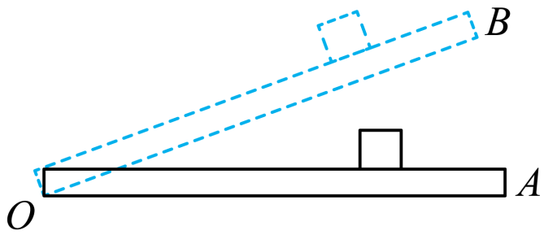

# Physics - 题目 1600

**ID**: 421d2fdaefc04131be5b989a07e1c783
**年级**: Grade 10
**难度**: Medium
**题型**: Multiple-choice

## 题目
如图所示，木板可绕固定水平轴 $O$ 转动，木板从水平位置 $OA$ 缓慢转到位置 $OB$ 的过程中，物块始终相对于木板静止，物块的重力势能增加了 ${{5}}{\rm{J}}$ ，用 $F{{}_{N}}$ 和 $F{{}_{f}}$ 分别表示物块受到的支持力和摩擦力，在此过程中，以下判断正确的是（      ）​​​​​​​‌

## 解答

1. A．物块受支持力的方向垂直木板向上，与物块运动的方向一致，所以支持力 $F{{}_{N}}$ 做正功，A错误；
2. BD．摩擦力的方向沿着木板向上与运动的方向垂直，所以 $F{{}_{f}}$ 不做功，BD错误；
3. C．重力势能增加了5J，则重力做功为 $W{{}_{G}}=-ΔE{{}_{P}}=-5{\rm{J}}$ ，根据动能定理，有 $W{{}_{F{{}_{N}}}}+W{{}_{G}}=0$ ，所以支持力做功为 $W{{}_{F{{}_{N}}}}=5{\rm{J}}{\rm ，C}$ 正确。选C。

## 知识点

**中文**:
  - 应用动能定理求解变力做功问题

**English**:
  - Solving Work Done by Variable Force

---
