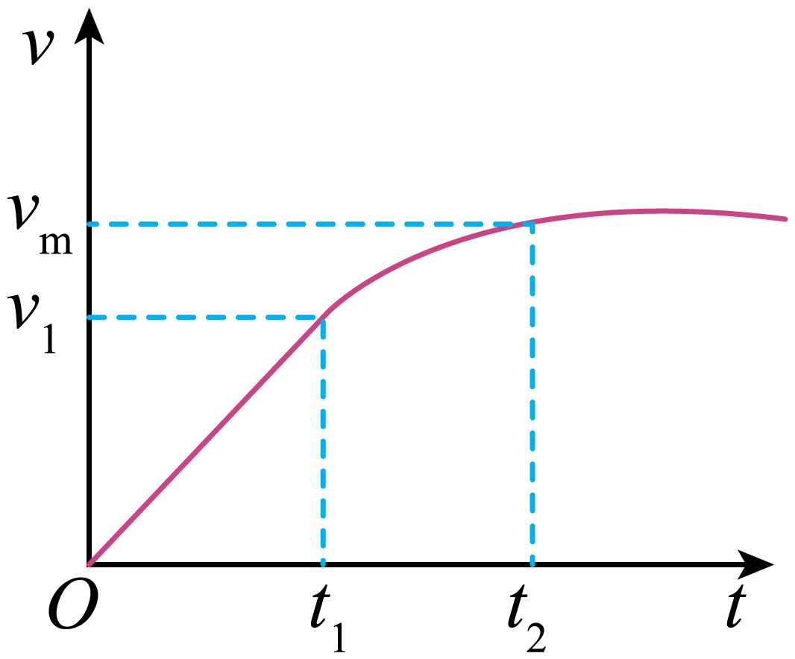

# Physics - 题目 666

**ID**: 4a9ca0177fa84d06878b6f15f5242182
**年级**: Grade 10
**难度**: Medium
**题型**: Multiple-choice

## 题目
小明驾驶两轮平衡车在水平路面上以恒定加速度 $a$ 启动 ${\rm ，}v-t$ 图像如图所示，已知人和平衡车的总质量为 $m{\rm ，}$ 平衡车动力系统的额定功率为 $P{{}_{0}}{\rm ，}$ 平衡车受到的阻力恒为 $f{\rm ，}$ 不计人对平衡车做功，则（      ）​​​​​​​‌

## 解答

1. B．当牵引力等于阻力时，平衡车速度达到最大，则有 $v{{}_{{\rm{m}}}}=\frac {P{{}_{0}}}{f}{\rm ，B}$ 错误；
2. CD．平衡车匀加速阶段，根据牛顿第二定律可得 $F{{}_{1}}-f=ma{\rm ，}$ 解得牵引力为 $F{{}_{1}}=f+ma{\rm ，}$ 平衡车做匀加速直线运动过程中能达到的最大速度为 $v{{}_{1}}=\frac {P{{}_{0}}}{F{{}_{1}}}=\frac {P{{}_{0}}}{f+ma}{\rm ，C}$ 正确，D错误；
3. A． $0\sim t{{}_{2}}$ 时间内，根据动能定理可得 $W{{}_{{\rm{F}}}}+W{{}_{{\rm{f}}}}=\frac {1}{2}mv{{}_{{\rm{m}}}^{2}}-0{\rm ，}$ 由于 $0\sim t{{}_{1}}$ 时间内平衡车的功率小于额定功率 $P{{}_{0}}{\rm ，}$ 可知 $0\sim t{{}_{2}}$ 时间内，牵引力做功 $W{{}_{{\rm{F}}}}\ne P{{}_{0}}t{{}_{2}}{\rm ，}$ 则阻力对平衡车做的功 $W{{}_{{\rm{f}}}}=\frac {1}{2}mv{{}_{{\rm{m}}}^{2}}-W{{}_{{\rm{F}}}}\ne \frac {1}{2}mv{{}_{{\rm{m}}}^{2}}-P{{}_{0}}t{{}_{2}}{\rm ，A}$ 错误。选C。

## 知识点

**中文**:
  - 机车启动的两种方式

**English**:
  - Two Modes of Locomotive Start-up

---
