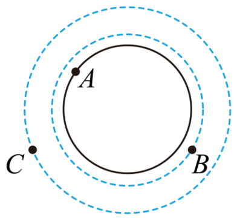

# Physics - 题目 1228

**ID**: 5978d447d1414f7da5bb1e7dbdb97fdb
**年级**: Grade 10
**难度**: Medium
**题型**: Multiple-choice

## 题目
地球赤道上的一个物体A，离地高度约 $200{\rm{k}}{\rm{m}}$ 的卫星B，地球的同步卫星C，它们运行的轨道示意图如图所示，它们都绕地心做匀速圆周运动．下列有关说法中正确的是（      ）​​​​​​​‌

## 解答

1. AB．对于AC运动的角速度相同，根据 $v=ωr$ ， $a=ω{^{2}}r$ ，可知 $v{{}_{{\rm{C}}}}>v{{}_{{\rm{A}}}}$ ， $a{{}_{{\rm{C}}}}>a{{}_{{\rm{A}}}}$ ，对于BC，根据 $G\frac {Mm}{r{^{2}}}=m\frac {v{^{2}}}{r}=ma$ ，可得 $v=\sqrt {\frac {GM}{r}}$ ， $a=\frac {GM}{r{^{2}}}$ ，可知 $v{{}_{{\rm{B}}}}>v{{}_{{\rm{C}}}}$ ， $a{{}_{{\rm{B}}}}>a{{}_{{\rm{C}}}}$ ，则它们运动的线速度大小关系即加速度关系是 $v{{}_{{\rm{B}}}}>v{{}_{{\rm{C}}}}>v{{}_{{\rm{A}}}}$  $a{{}_{{\rm{B}}}}>a{{}_{{\rm{C}}}}>a{{}_{{\rm{A}}}}$ 选项A错误，B正确；
2. C．已知A运动的周期 $T{{}_{{\rm{A}}}}=24{\rm{h}}$ ，可知同步卫星的周期 $T{{}_{C}}=24{\rm{h}}$ 根据 $G\frac {Mm}{{\left({R+h{{}_{C}}}\right)^{2}}}=m\frac {4π{^{2}}}{T{{}_{A}^{2}}}\left ({R+h{{}_{C}}}\right )$ ， $ρ=\frac {M}{\frac {4}{3}πR{^{3}}}$ ，可计算出地球的密度 $ρ=\frac {3π(R+h{{}_{C}}){^{3}}}{GT{{}_{{\rm{A}}}^{{{2}}}}R{^{3}}}$ ，选项C错误；
3. D．已知B运动的周期 $T{{}_{{\rm{B}}}}$ 及地球半径 $r{{}_{{\rm{B}}}}$ ，则 $G\frac {Mm}{(r{{}_{B}}+h{{}_{B}}){^{2}}}=m\frac {4π{^{2}}}{T{{}_{B}^{2}}}(r{{}_{B}}+h{{}_{B}})$ ，可计算出地球质量 $M=\frac {4π{^{2}}(r{{}_{B}}+h{{}_{B}}){^{3}}}{GT{{}_{{\rm{B}}}^{{{2}}}}}$ ，选项D错误。选B。

## 知识点

**中文**:
  - 近地卫星、同步卫星和赤道上随地球自转物体的分析比较

**English**:
  - Comparison: Near-Earth, Geostationary Satellites and Objects on Equator

---
