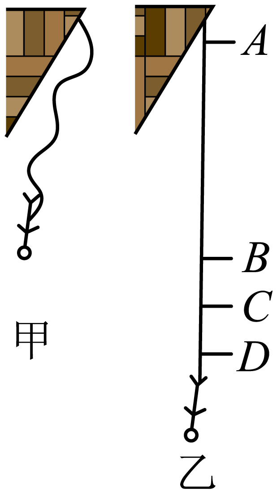

# Physics - 题目 350

**ID**: 647d6022f64b4e9db673a3664bae22e6
**年级**: Grade 10
**难度**: Medium
**题型**: Multiple-choice

## 题目
图甲是玩家玩“蹦极”游戏的真实照片。​​​​​​​‌玩家将一根长为AB的弹性绳子的一端系在身上，另一端固定在高处，然后从高处跳下，图乙是玩家到达最低点时的情况，其中AB为弹性绳子的原长，C点是弹力等于重力的位置，D点是玩家所到达的最低点，不计空气阻力，对于玩家离开跳台至最低点的过程中，下列说法正确的是（      ）

## 解答

1. 玩家A到B做自由落体运动，C点是弹力等于重力的位置，B到C做加速运动，C到D做减速运动，玩家在B到D过程加速度先减小后增大，AD错误；玩家A到B过程中，做自由落体运动，绳子的弹性势能为零；从B到D过程，弹性绳子一直伸长，弹性势能一直增大，B正确；从A到D，高度一直减小，重力势能一直减小，C错误。

## 知识点

**中文**:
  - 弹性势能的变化与弹力做功的关系
  - 重力势能的变化与重力做功的关系

**English**:
  - Change in Elastic PE and Work Done by Elastic Force
  - Change in Gravitational PE and Work Done by Gravity

---
