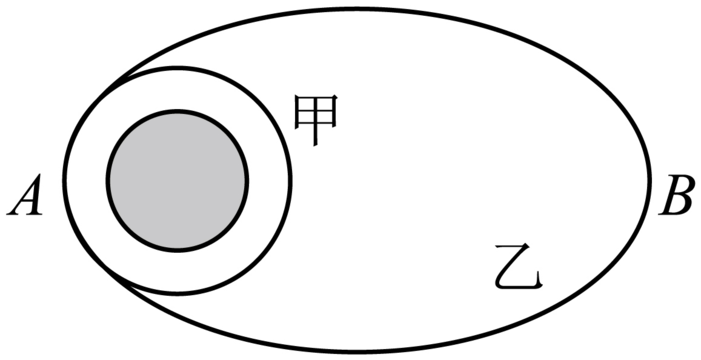

# Physics - 题目 2545

**ID**: 7756df5c1f454123895ca97094828492
**年级**: Grade 10
**难度**: Medium
**题型**: Multiple-choice

## 题目
火星一直被科学家视为人类的第二家园，人类很可能在二十一世纪内成功移民火星。​​​​​​​‌如图所示，火星的半径为 $R$ ，甲、乙两种探测器分别绕火星做匀速圆周运动与椭圆轨道运动，两种轨道相切于椭圆轨道的近火点A，圆轨道距火星表面的高度为 $\frac {R}{2}$ ，椭圆轨道的远火点 $B$ 与近火点A之间的距离为 $8R$ ，若甲的运动周期为 $T$ ，则下列说法正确的是（      ）

## 解答

1. AB．根据题意可得，甲的公转轨道半径为 $r{{}_{甲}}=\frac {3}{2}R$ ，乙的椭圆运动的半长轴为 $r{{}_{乙}}=\frac {8R}{2}=4R$ ，设乙的运动周期为 $T{{}_{乙}}$ ，由开普勒第三定律 ${\left({\frac {T{{}_{乙}}}{T}}\right)^{2}}={\left({\frac {r{{}_{乙}}}{r{{}_{甲}}}}\right)^{3}}$ ，综合解得 $T{{}_{乙}}=\frac {16\sqrt {6}}{9}T{\rm ，A}$ 正确,B错误；
2. C．开普勒第二定律中相同时间内扫过的面积相等是对于同一天体，C错误；
3. D．由近火点向远火点运动，根据 $F=G\frac {Mm}{r{^{2}}}$ 可知其所受引力变小，根据牛顿第二定律可知其加速度变小，D错误。选A。

## 知识点

**中文**:
  - 卫星变轨与对接问题

**English**:
  - Satellite Orbit Change and Docking

---
