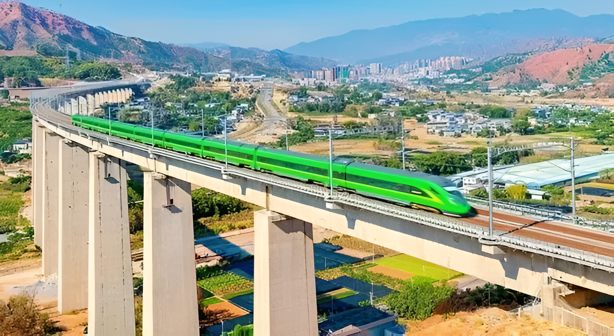

# Physics - 题目 336

**ID**: 88104fa48da649ee91af7304dfafb24a
**年级**: Grade 10
**难度**: Medium
**题型**: Multiple-choice

## 题目
2020年1月9日攀枝花至昆明动车正式开通，攀枝花进入“动车时代”。​​​​​​​‌动车每节车厢长度约为25m，整车长度约为250m。某次乘务员相对车厢以2m/s的速度通过两节车厢的过程中，全车恰好通过一座大桥，车上显示时速度为144km/h，则该大桥的长度约为（      ）

## 解答

1. 动车整车的长度为
2. $s=250{\rm{m}}$
3. 动车每节车厢长度约为
4. $L=25{\rm{m}}$
5. 乘务员通过两节车厢的时间为
6. $t=\frac {2L}{v{^{^{′}}}}=\frac {2\times 25}{2}{\rm{s}}=25{\rm{s}}$
7. 设大桥的长度为x，根据题意有
8. $s+x=vt$
9. 代入数据解得
10. $x=750{\rm{m}}$
11. 故选A。

## 知识点

**中文**:
  - 匀变速直线运动基本公式的灵活应用

**English**:
  - Flexible Application of Basic UVRM Formulas

---
