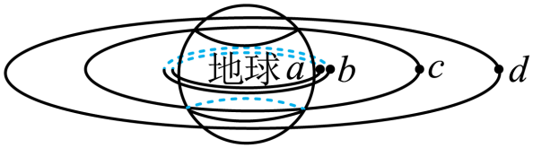

# Physics - 题目 1126

**ID**: 919a45ff690d4e268339c36c2a4315f0
**年级**: Grade 10
**难度**: Medium
**题型**: Multiple-choice

## 题目
如题图所示，a为固定在赤道上跟随地球自转的物体，b、c、d是三颗在地球赤道上空做匀速圆周运动的卫星，已知b卫星轨道半径约为地球半径，c是地球同步卫星，d是高空探测卫星，且各卫星排列位置如题图所示，则下列说法正确的是（      ）​​​​​​​‌

## 解答

1. 物体a和卫星c的角速度相同，根据 $v=ωr$ ，可知，物体a的线速度小于卫星c的线速度，选项A错误；根据开普勒第三定律 $\frac {r{^{3}}}{T{^{2}}}=k$ ，可知卫星d的周期一定大于卫星c的周期，则一定大于地球自转周期，选项B错误；根据 $a=ω{^{2}}r$ ，可知物体a的向心加速度小于卫星c的向心加速度；根据 $a=\frac {GM}{r{^{2}}}$ ，可知卫星c的向心加速度小于卫星b的向心加速度，可知物体a的向心加速度小于卫星b向心加速度，选项C错误；根据 $G\frac {Mm}{r{^{2}}}=m\frac {v{^{2}}}{r}$ ，可得到 $v=\sqrt {\frac {GM}{r}}$ ，可知 $v{{}_{b}}>v{{}_{c}}>v{{}_{d}}$ ，而 $v{{}_{c}}>v{{}_{a}}$ ，所以卫星b的线速度最大，根据l=vt可知，abcd四个对象中在相同时间内转过的弧长最长的是卫星b，选项D正确。

## 知识点

**中文**:
  - 近地卫星、同步卫星和赤道上随地球自转物体的分析比较

**English**:
  - Comparison: Near-Earth, Geostationary Satellites and Objects on Equator

---
