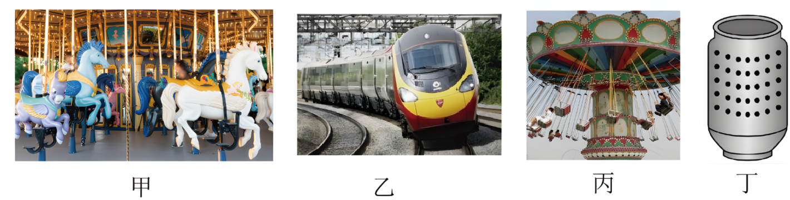

# Physics - 题目 1972

**ID**: 95062923002b4d569fac941ab1d4734f
**年级**: Grade 10
**难度**: Medium
**题型**: Multiple-choice

## 题目
教科书在描述圆周运动时设置了许多插图，下列关于插图表述正确的是（      ）​​​​​​​‌

## 解答

1. 图甲旋转木马工作时，根据 $v=ωr$ ，可知越靠内侧的木马线速度越小，A错误；图乙在铁路弯道处，轨道外轨略高于内轨，利用重力和支持力的合力提供向心力，B正确；图丙“空中飞椅”游戏过程中，钢绳对座椅的拉力和座椅的重力的合力提供向心力，C错误；图丁洗衣机的脱水桶在工作时，衣服中的水珠受到的附着力不足以提供所需的向心力时从桶孔飞出，D错误。

## 知识点

**中文**:
  - 火车转弯问题
  - 线速度、角速度和周期、转速
  - 离心运动及其应用

**English**:
  - Train Turning Problems
  - Linear Velocity, Angular Velocity, Period, and Rotational Speed
  - Centrifugal Motion and Applications

---
