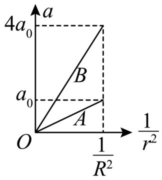

# Physics - 题目 2096

**ID**: a6842abb8b124d078f52f770a617d1cf
**年级**: Grade 10
**难度**: Medium
**题型**: Multiple-choice

## 题目
假设宇宙中有两颗相距很远、互不影响的行星A、B，各有一颗“近地”卫星P、Q绕其做匀速圆周运动。​​​​​​​‌行星周围空间某位置的引力加速度为a，该位置到行星中心距离为r， $a-\frac {1}{r{^{2}}}$ 关系如图所示，卫星P、Q的引力加速度大小分别为 $a{{}_{0}}$ 、 $4a{{}_{0}}$ ，则下列说法正确的是（      ）

## 解答

1. A．由题给信息无法计算卫星P、Q的质量之比，故A错误；
2. B．由题图可知，行星A、B的半径相等且都为R，由
3. $ma=G\frac {Mm}{R{^{2}}}$
4. 可得
5. $M{{}_{A}}:M{{}_{B}}=a{{}_{A}}:a{{}_{B}}=1:4$
6. 故B错误：
7. C．由
8. $G\frac {Mm}{R{^{2}}}=m\frac {v{^{2}}}{R}$
9. 可得
10. $v{{}_{A1}}:v{{}_{B1}}=\sqrt {M{{}_{A}}}:\sqrt {M{{}_{B}}}=1:2$
11. 故C正确；
12. D．由
13. $ma=G\frac {Mm}{R{^{2}}}$
14. 可得
15. $M=\frac {aR{^{2}}}{G}$
16. 所以行星的密度
17. $ρ=\frac {M}{V}=\frac {aR{^{2}}}{G}\cdot \frac {3}{4πR{^{3}}}=\frac {3a}{4πGR}$
18. 所以行星A、B的密度之比
19. $ρ{{}_{A}}:ρ{{}_{B}}=1:4$
20. 故D错误。
21. 故选C。
22. 【点睛】
23. $a-\frac {1}{r{^{2}}}$ 图像中反映出的物理意义是解答本题的关键，一般图像中的物理量的解读需要关注图像中的交点、拐点、斜率、面积等。

## 知识点

**中文**:
  - 万有引力定律问题的分析与计算
  - 天体质量的计算
  - 天体密度的计算

**English**:
  - Analysis and Calculation of Gravitation Problems
  - Calculation of Celestial Mass
  - Calculation of Celestial Density

---
