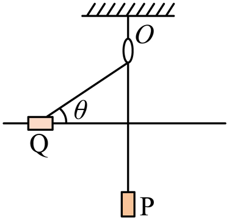

# Physics - 题目 1817

**ID**: ad738a9234024a3a98788198b4d71483
**年级**: Grade 10
**难度**: Medium
**题型**: Multiple-choice

## 题目
如图所示，水平长杆上套一物块Q，轻绳穿过光滑圆环连接物体 ${\rm{P}}、{\rm{Q}}$ ，某时刻由静止释放 ${\rm{P}}、{\rm{Q}}$ ，释放时左侧轻绳与水平方向夹角为 $θ$ ，不计一切摩擦，下列说法正确的是（      ）​​​​​​​‌

## 解答

1. 根据题意，由图可知，P、Q沿绳方向的速度大小始终相同，但P、Q速度大小不相同，A错误； $θ=90{}\degree $ 时，Q在O点正下方，速度方向水平，绳子与运动方向垂直，Q沿绳方向速度为零，所以P的速度为零，B正确；根据上述分析可知，P的速度是从0到0，所以加速度先向下后向上，先失重后超重，C错误；机械能的变化量看除重力以外的其他力做功，即绳的拉力做功， $θ$ 向 $90{}\degree $ 增大的过程中，P一直向下运动，绳的拉力做负功，机械能一直减小，D错误。

## 知识点

**中文**:
  - 功和功率
  - 超重和失重

**English**:
  - Work and Power
  - Overweight and Weightlessness

---
