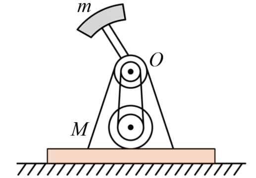

# Physics - 题目 1110

**ID**: be5537c3dd534b2b956f4b05a7f66ce2
**年级**: Grade 10
**难度**: Medium
**题型**: Multiple-choice

## 题目
如图是小型电动打夯机的结构示意图，电动机带动质量为 $m=50{\rm{k}}{\rm{g}}$ 的重锤（重锤可视为质点）绕转轴O匀速圆周运动，重锤转动半径为 $R=0.5{\rm{m}}$ ，电动机连同打夯机底座的质量为 $M=25{\rm{k}}{\rm{g}}$ ，重锤和转轴O之间连接杆的质量可以忽略不计。​​​​​​​‌下列说法中不正确的是（      ）

## 解答

1. A．重锤在最高点时，当连接杆对重锤的拉力大小等于电动机连同打夯机底座的重力时，打夯机底座对地面压力为零，即 $mg+Mg=mω{^{2}}R$ ，解得 $ω=\sqrt {30}{\rm{r}}{\rm{a}}{\rm{d}}{\rm{/}}{\rm{s}}$ ，A正确；
2. B．重锤在最高点时，当重锤的重力恰好提供向心力时，连接杆对重锤的作用力为零，即 $mg=m\frac {v{^{2}}}{R}$ ，解得 $v=\sqrt {5}{\rm{m}}{\rm{/}}{\rm{s}}$ ，B正确；
3. C．当打夯机在地面上稳定工作恰好不晃动时，地面对机器提供的最大作用力为 $F{{}_{{\rm{N}}}}=(m+M)g+mω{^{2}}R=1500{\rm{N}}$ ，C错误；
4. D．重锤从最高点运动到最低点的过程中，动能不变，重力势能减小，所以重锤的机械能不守恒，D正确。本题要求选择不正确的，选C。

## 知识点

**中文**:
  - 竖直面内圆周运动问题

**English**:
  - Circular Motion in Vertical Plane

---
