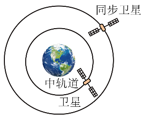

# Physics - 题目 1293

**ID**: c19d9a39d232423085850fbc170d7481
**年级**: Grade 10
**难度**: Medium
**题型**: Multiple-choice

## 题目
我国北斗系统主要由离地面高度约为 $6R$ （R为地球半径）的地球同步轨道卫星和离地面高度约为 $3R$ 的中轨道卫星组成，忽略地球自转。​​​​​​​‌两卫星相比较，下列说法正确的是（      ）

## 解答

1. A．卫星万有引力提供向心力，根据 $G\frac {Mm}{r{^{2}}}=m\frac {4\mathrm{π}{^{2}}}{T{^{2}}}r$ ， $T=2π\sqrt {\frac {r{^{3}}}{GM}}$ ，中轨道卫星的轨道半径较小，则其周期较小，A正确；
2. B．根据 $G\frac {Mm}{r{^{2}}}=m\frac {v{^{2}}}{r}$ ， $v=\sqrt {\frac {GM}{r}}$ ，中轨道卫星的轨道半径较小，则其线速度较大，B错误；
3. C．根据 $G\frac {Mm}{r{^{2}}}=mω{^{2}}r$ ， $ω=\sqrt {\frac {GM}{r{^{3}}}}$ ，中轨道卫星的轨道半径较小，则其角速度较大，C错误；
4. D．根据 $G\frac {Mm}{r{^{2}}}=ma$ ， $a=\frac {GM}{r{^{2}}}$ ，中轨道卫星的轨道半径较小，则其向心加速度较大，D错误。选A。

## 知识点

**中文**:
  - 万有引力定律问题的分析与计算

**English**:
  - Analysis and Calculation of Gravitation Problems

---
