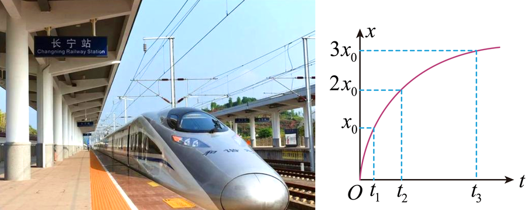

# Physics - 题目 254

**ID**: c2bfb8b7c9b3484aaf7cec9fbc8a835e
**年级**: Grade 10
**难度**: Medium
**题型**: Multiple-choice

## 题目
一列复兴号动车进站时做匀减速直线运动，车头经过站台上三个立柱A、B、C，对应时刻分别为 $t{{}_{1}}$ ， $t{{}_{2}}$ ， $t{{}_{3}}$ ，其 $x-t$ 图像如图所示。​​​​​​​‌则下列说法正确的是（      ）

## 解答

1. A．对于初速度为0的匀加速直线运动，连续相邻相等位移内的时间比为
2. $t{{}_{1}}:t{{}_{2}}:t{{}_{3}}=1:(\sqrt {2}-1):(\sqrt {3}-\sqrt {2}){\rm \mathit{x}}$  −t图像的斜率表示速度，根据图像可知，车头经过A、B、C过程相邻立柱的间距相等，但是车头经过立柱C时的速度并不为0，根据逆向思维可知，通过的时间不满足比例关系，故A错误；
3. B．位移时间图像中斜率代表速度， $\frac {2x{{}_{0}}}{t{{}_{2}}}$ 为经过立柱B对应图像割线的斜率，比对应图像的斜率大，所以经过立柱B的速度小于 $\frac {2x{{}_{0}}}{t{{}_{2}}}$ ，故B错误；
4. C．t_{1}~t_{2}时间内中间时刻的瞬时速度为 $v{{}_{1}}=\frac {2x{{}_{0}}-x{{}_{0}}}{t{{}_{2}}-t{{}_{1}}}=\frac {x{{}_{0}}}{t{{}_{2}}-t{{}_{1}}}{\rm ，\mathit{t}\mathit{_{2}}}$  ~t_{3}时间内中间时刻的速度为 $v{{}_{2}}=\frac {3x{{}_{0}}-2x{{}_{0}}}{t{{}_{3}}-t{{}_{2}}}\frac {x{{}_{0}}}{t{{}_{3}}-t{{}_{2}}}$ ，由加速度的定义式得 $a=\frac {v{{}_{2}}-v{{}_{1}}}{\frac {t{{}_{3}}-t{{}_{2}}}{2}+\frac {t{{}_{2}}-t{{}_{1}}}{2}}$ ，联立解得 $a=\frac {2x{{}_{0}}(2t{{}_{2}}-t{{}_{1}}-t{{}_{3}})}{(t{{}_{3}}-t{{}_{2}})(t{{}_{3}}-t{{}_{1}})(t{{}_{2}}-t{{}_{1}})}$ ，故C错误；
5. D．平均速度等于总位移与总时间的比值，则车头经过立柱A、B过程中的平均速度大小为 $\bar v=\frac {2x{{}_{0}}-x{{}_{0}}}{t{{}_{2}}-t{{}_{1}}}=\frac {x{{}_{0}}}{t{{}_{2}}-t{{}_{1}}}$ ，故D正确。选D。

## 知识点

**中文**:
  - 逆向思维法在匀变速直线运动中的应用

**English**:
  - Reverse Thinking in UVRM Problems

---
