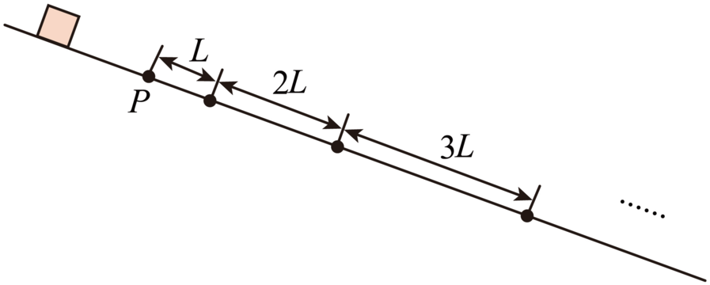

# Physics - 题目 1328

**ID**: d5646c6cf0764c879b12298561024ee8
**年级**: Grade 10
**难度**: Medium
**题型**: Multiple-choice

## 题目
如图所示，物块在足够长光滑斜面上的O点（未标出）由静止释放，从经过P点开始计时，物块在连续相等时间内通过的位移分别为L、2L、3L、…、nL，则OP的距离为（      ）​​​​​​​‌

## 解答

1. 根据匀变速直线运动相邻相等时间内的位移差规律有 $2L-L=aT{^{2}}$ ，匀变速直线运动全程的平均速度等于中间时刻的瞬时速度，则图示第一个T的末状态的速度 $v=\frac {L+2L}{2T}=\frac {3L}{2T}$ ，根据速度与位移的关系有 $v{^{2}}=2a\left ({x{{}_{OP}}+L}\right )$ ，解得 $x{{}_{OP}}=\frac {1}{8}L$ 。

## 知识点

**中文**:
  - 匀变速直线运动的速度—位移公式及其应用
  - 匀变速直线运动重要推论的应用

**English**:
  - Velocity-Displacement Formula and Applications
  - Applications of Important UVRM Corollaries

---
