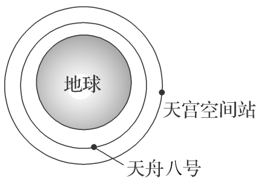

# Physics - 题目 1935

**ID**: f0ce15a4f1ca4fd58329ee5a735a3fe3
**年级**: Grade 10
**难度**: Medium
**题型**: Multiple-choice

## 题目
天舟八号货运飞船入轨后顺利完成状态设置，于北京时间2024年11月16日2时32分，成功对接于空间站天和核心舱后向端口。​​​​​​​‌对接后的“结合体”仍在空间站原轨道运行。对接前“天宫空间站”与“天舟八号”的轨道如图所示，则（      ）

## 解答

1. “天舟八号”与“天宫空间站”对接前绕地球做匀速圆周运动，万有引力提供向心力有 $\frac {GMm}{r{^{2}}}=m\frac {4π{^{2}}}{T{^{2}}}r=m\frac {v{^{2}}}{r}=ma$ ，解得 $T=2π\sqrt {\frac {r{^{3}}}{GM}}，v=\sqrt {\frac {GM}{r}}，a=\frac {GM}{r{^{2}}}$ ，“天舟八号”的轨道半径小于“天宫空间站”的轨道半径，则“天宫空间站”的线速度小于“天舟八号”的线速度，“天宫空间站”的向心加速度小于“天舟八号”的向心加速度，对接后“结合体”绕地球公转周期等于对接前“天宫空间站”的公转周期，故AD错误，C正确；“天舟八号”需要经过点火加速才能从低轨道变轨进入高轨道，实现对接，故B错误。

## 知识点

**中文**:
  - 万有引力定律问题的分析与计算

**English**:
  - Analysis and Calculation of Gravitation Problems

---
