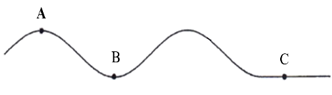

# Physics - 题目 794

**ID**: fb4e1f32003148029e1568e27d63f89a
**年级**: Grade 10
**难度**: Medium
**题型**: Multiple-choice

## 题目
一辆货车在崎岖道路上匀速率行驶，途中发生了爆胎。​​​​​​​‌道路地形如图所示，则爆胎可能性最大的位置是图中的（      ）

## 解答

1. 在A点时有
2. $mg-N{{}_{A}}=m\frac {v{^{2}}}{r}$
3. 解得
4. $N{{}_{A}}=mg-m\frac {v{^{2}}}{r}$
5. 在B点时有
6. $N{{}_{B}}-mg=m\frac {v{^{2}}}{r}$
7. 解得
8. $N{{}_{B}}=mg+m\frac {v{^{2}}}{r}$
9. 在C点时有
10. $N{{}_{C}}=mg$
11. 根据
12. $f=μN$
13. 可知，正压力越大摩擦力越大，则在B点时正压力最大，爆胎可能性最大的位置是图中的B处，所以B正确；ACD错误；
14. 故选B。

## 知识点

**中文**:
  - 汽车过桥问题

**English**:
  - Car Crossing Bridge Problems

---
