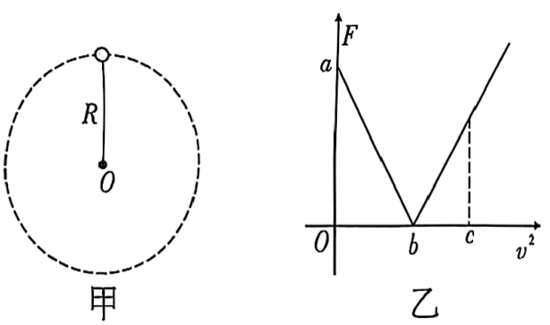

# Physics - 题目 642

**ID**: 0955356385c04916adec1fc4984e9a60
**年级**: Grade 10
**难度**: Medium
**题型**: Multiple-select

## 题目
如图甲所示，轻杆一端固定在O点，另一端固定质量为m的小球。​​​​​​​‌现让小球在竖直平面内做圆周运动，小球运动到最高点时，杆与小球间弹力大小为F，速度大小为v，其 $F-v{^{2}}$ 图像如图乙所示。则（      ）

## 解答

1. 由图乙知，当 $v{^{2}}=0$ 时弹力大小与小球重力等大，即 $F=mg=a$ ，当 $F=0$ 时 $v{^{2}}=b$ ，则小球恰好通过最高点，根据牛顿第二定律有 $mg=m\frac {v{^{2}}}{R}$ ，把 $v{^{2}}=b$ 代入，联立解得 $R=\frac {mb}{a}$ 、 $g=\frac {b}{R}{\rm ，A}$ 错误，B正确；由图可知当 $v{^{2}}<b$ 时，杆对小球弹力方向向上；当 $v{^{2}}>b$ 时，杆对小球弹力方向向下，所以当 $v{^{2}}=c>b$ 时，杆对小球弹力方向向下，C错误；当 $v{^{2}}=2b$ 时，由牛顿第二定律有 $F^{′}+mg=m\frac {v{^{2}}}{R}$ ，整理得 $F^{′}+mg=m\frac {2b}{R}$ ，联立以上各式可知小球受到的弹力 $F^{′}$ 大小等于 $mg{\rm ，D}$ 正确。

## 知识点

**中文**:
  - 绳、杆类圆周运动问题

**English**:
  - String and Rod Circular Motion Problems

---
