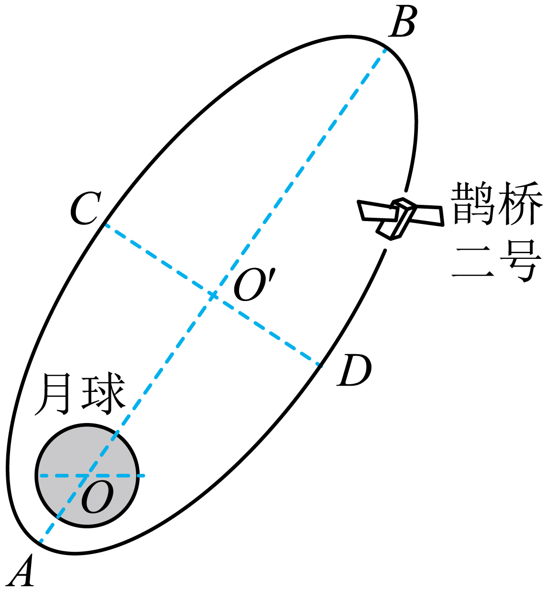

# Physics - 题目 3005

**ID**: 0a1646db997e4c85a84849f1f54001c1
**年级**: Grade 10
**难度**: Medium
**题型**: Multiple-select

## 题目
我国“鹊桥二号”通导技术试验卫星发射升空，卫星主要用于地月空间通导技术验证。​​​​​​​‌“鹊桥二号”采用周期为24h的环月椭圆冻结轨道（如图），A点为近月点，B点为远月点，CD为椭圆轨道的短轴，下列有关“鹊桥二号”的说法正确的是（      ）

## 解答

1. “鹊桥二号”采用周期为24h，根据运动特点可知从A经C到B的运动时间为12h，故A正确；从A经C到B的运动过程中“鹊桥二号”受到的万有引力逐渐减小，所以“鹊桥二号”加速度逐渐减小，故B错误；“鹊桥二号”从A经C到B的运动过程中，引力做负功，速度逐渐减小，故C正确；“鹊桥二号”在C、D点受到月亮的万有引力，加速度方向指向月球球心，故D错误。

## 知识点

**中文**:
  - 功和功率
  - 卫星变轨与对接问题

**English**:
  - Work and Power
  - Satellite Orbit Change and Docking

---
