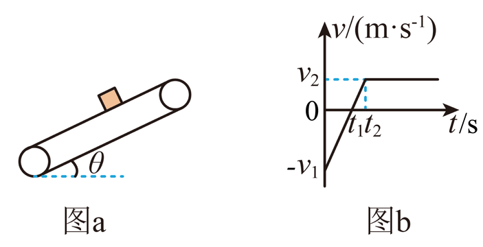

# Physics - 题目 1880

**ID**: 10d143ab2cce488389ffdd60a8dcaf95
**年级**: Grade 10
**难度**: Medium
**题型**: Multiple-select

## 题目
已知一足够长的传送带与水平面的倾角为θ，以一定的速度匀速运动。​​​​​​​‌某时刻在传送带适当的位置放上一个具有一定初速度的物块（如图a所示），以此时为 $t=0$ 时刻，记录小物块之后在传送带上运动的速度随时间的变化关系，如图b所示（图中取沿传送带向上的运动方向为正方向，其中速度大小 $v{{}_{1}}>v{{}_{2}}$ ）。已知传送带的速度保持不变，则下列判断正确的是（      ）

## 解答

1. 通过 $v-t$ 图像分析可知，物块先向下做匀减速直线运动，再向上做匀加速直线运动，最后向上做匀速直线运动，可得传送带的运动方向是沿顺时针方向，A正确；在 $t{{}_{1}}$ ~ $t{{}_{2}}$ 时间内，物块沿传送带向上加速运动，则有 ${\rm μm}g{\cos}θ$ > $mg\sin θ$ ，可见 $μ$ > ${\tan}θ{\rm ，B}$ 正确；由 $v-t$ 图像与时间轴围成的面积表示位移可知，0~ $t{{}_{2}}$ 时间内，物块的总位移沿传送带向下，高度下降，重力必然对物块做正功，根据动能定理可知，0~ $t{{}_{2}}$ 时间内，合外力对物块做的功等于 $\frac {1}{2}m(v{{}_{2}^{2}}-v{{}_{1}^{2}})$ ，传送带对物体做功不等于 $\frac {1}{2}m(v{{}_{2}^{2}}-v{{}_{1}^{2}}){\rm ，C}$ 错误；由能量守恒可知，物块克服摩擦力做的功一定等于物块机械能的减少量，D正确。选ABD。

## 知识点

**中文**:
  - 传送带模型中的能量守恒问题

**English**:
  - Energy Conservation in Conveyor Belt Models

---
