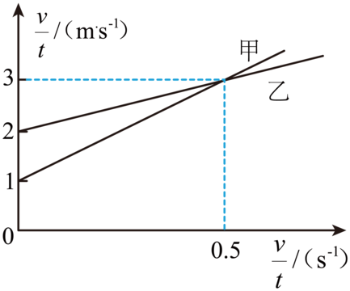

# Physics - 题目 1726

**ID**: 21d269d96fea473ea939befb99c73847
**年级**: Grade 10
**难度**: Medium
**题型**: Multiple-select

## 题目
甲、乙两玩具车沿同一方向做匀加速直线运动，当同时通过某一位置时开始计时，得到它们的 $\frac {v}{t}-\frac {1}{t}$ 图像如图所示。​​​​​​​‌关于甲、乙两玩具车，下列说法正确的是（      ）

## 解答

1. 根据匀变速直线运动中速度—时间公式 $v=v{{}_{0}}+at$ ，化简变形有 $\frac {v}{t}=v{{}_{0}}\cdot \frac {1}{t}+a$ ，结合图像可知，甲玩具车的初速度大小 $v{{}_{0甲}}=\frac {3-1}{0.5}{\rm{m}}/{\rm{s}}=4{\rm{m}}/{\rm{s}}$ ；乙玩具车的初速度大小 $v{{}_{0乙}}=\frac {3-2}{0.5}{\rm{m}}/{\rm{s}}=2{\rm{m}}/{\rm{s}}$ 。甲玩具车的加速度大小 $a{{}_{甲}}=1{\rm{m}}/{\rm{s}}{^{2}}$ ；乙玩具车的加速度大小 $a{{}_{乙}}=2{\rm{m}}/{\rm{s}}{^{2}}{\rm ，A}$ 错误，B正确；甲、乙两玩具车位移相等时，有 $v{{}_{0甲}}t+\frac {1}{2}a{{}_{甲}}t{^{2}}=v{{}_{0乙}}t+\frac {1}{2}a{{}_{乙}}t{^{2}}$
2. 解得 $t=4{\rm{s}}{\rm ，C}$ 错误；甲，乙两玩具车相遇前速度相等时相距最远，有 $v{{}_{0甲}}+a{{}_{甲}}t^{′}=v{{}_{0乙}}+a{{}_{乙}}t^{′}$ ，解得 $t^{′}=2{\rm{s}}$ ，最大距离 ${\rm{Δ}}x=v{{}_{0}}$_{甲}$t^{′}+\frac {1}{2}a{{}_{甲}}t^{′}{{^{2}}}-\left ({v{{}_{0乙}}t^{′}+\frac {1}{2}a{{}_{乙}}t^{′}{{^{2}}}}\right )=2{\rm{m}}{\rm ，D}$ 正确。

## 知识点

**中文**:
  - 追及与相遇问题

**English**:
  - Chase and Encounter Problems

---
