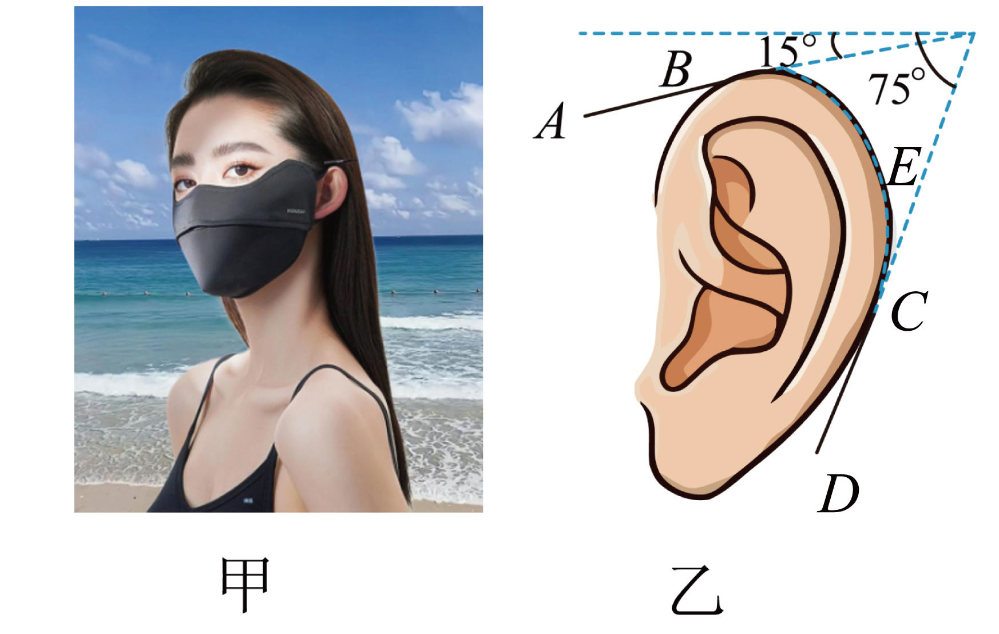

# Physics - 题目 933

**ID**: 30eca30026c942f692a6218140d636ef
**年级**: Grade 10
**难度**: Medium
**题型**: Multiple-select

## 题目
如图甲所示，夏日炎炎，紫外线强烈，很多爱美人士为了保护好自己脸部的肌肤都选择了佩戴防晒口罩。​​​​​​​‌图乙为一侧耳朵佩戴口罩的示意图，一侧的口罩带是由直线AB、弧线BEC和直线CD组成的。AB和CD两段口罩带与水平方向夹角分别为15°和75°。假若口罩带可认为是一段劲度系数为k=200N/m的弹性轻绳，在佩戴好口罩后弹性轻绳被拉长了2.5cm。轻质弹性绳涉及到的受力均在同一平面内，忽略一切摩擦，则下列说法正确的是（      ）

## 解答

1. 设耳朵分别受到 $AB、CD$ 段口罩带的拉力为 $T$ ，如图所示
2. 
3. 根据几何关系可得作用力方向与水平方向夹角 $θ=15{}\degree +\frac {75{}\degree -15{}\degree }{2}=45{}\degree {\rm ，A}$ 正确，B错误；由胡克定律可得 $T=kx=5{\rm{N}}$ ，耳朵受到的口罩带的作用力为 $F=2T{\rm{c}}{\rm{o}}{\rm{s}}\frac {75{}\degree -15{}\degree }{2}=5\sqrt {3}{\rm{N}}{\rm ，C}$ 正确，D错误。

## 知识点

**中文**:
  - 用正交分解法分析问题

**English**:
  - Problem Analysis using Orthogonal Decomposition

---
