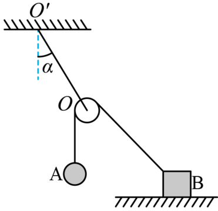

# Physics - 题目 1570

**ID**: 3d929133ee354616abb867a2f99ee346
**年级**: Grade 10
**难度**: Medium
**题型**: Multiple-select

## 题目
如图所示，一条细线一端与地板上的物体B相连，另一端绕过质量不计的定滑轮与小球A相连，定滑轮用另一条细线悬挂在天花板上的 $O{^{\prime }}$ 点，细线与竖直方向所成角度为α，开始时系统静止，则（      ）​​​​​​​‌

## 解答

1. AB．对小球A受力分析，受重力和拉力，根据平衡条件有
2. $T=mg$
3. 如果将物体B在地板上向右移动稍许，则 $\angle AOB$ 增加，对滑轮分析，受三个拉力，如图所示
4. 
5. 根据平衡条件得
6. $\angle AOB=2α$
7. 故 $α$ 一定增大，故A正确，B错误；
8. C．增大小球A的质量，若B仍保持不动，系统平衡，则 $α$ 不变，故C错误；
9. D．由于
10. $\angle AOB=2α<90{}^\circ $
11. 弹力 $F$ 与两个拉力 $T$ 的合力平衡，而
12. $T=mg$
13. 故定滑轮的细线的弹力一定大于小球A的重力，故D正确。
14. 故选AD。

## 知识点

**中文**:
  - 解析法在解动态平衡问题中的应用

**English**:
  - Analytical Method for Dynamic Equilibrium

---
