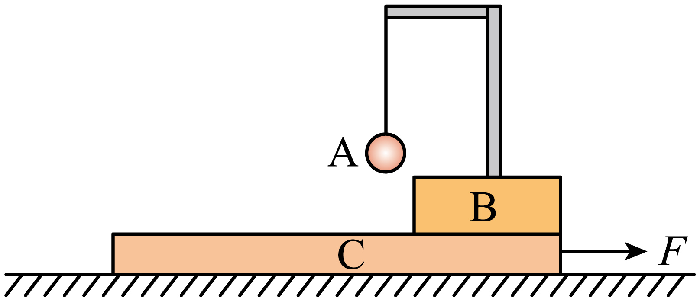

# Physics - 题目 2944

**ID**: 41994fdc1cc24621a6f2fa99d2111b3b
**年级**: Grade 10
**难度**: Medium
**题型**: Multiple-select

## 题目
如图所示，光滑水平面上放置木板C，一支架B放置在木板C上，一段细线上端固定在支架上，下端连接小球A。​​​​​​​‌已知小球A、支架B、木板C质量分别为1kg、2kg、3kg，支架B底座与木板C之间的动摩擦因数 $μ=0.75$ ，现对木板施加向右水平的拉力F，设最大静摩擦力等于滑动摩擦力， $\sin 53{}\degree ={\cos}37{}\degree =0.8$ ， ${\cos}53{}\degree =\sin 37{}\degree =0.6$ ，重力加速度g取 $10{\rm{m}}{\rm{/}}{\rm{s}}{^{{{2}}}}$ ，下列说法正确的是（      ）

## 解答

1. 根据题意可知，支架B与木板C间发生滑动时，支架B与小球A的加速度最大，有 $f=μ\left ({m{{}_{{\rm{A}}}}+m{{}_{{\rm{B}}}}}\right )g=\left ({m{{}_{{\rm{A}}}}+m{{}_{B}}}\right )a{{}_{0}}$ ，即 $a{{}_{0}}=μg=7.5{\rm{m}}{\rm{/}}{\rm{s}}{^{{{2}}}}$ ，此时细线与竖直方向夹角最大为 $θ$ ，选小球A为研究对象，则有 $T{\cos}θ=m{{}_{{\rm{A}}}}g$ ， $T\sin θ=m{{}_{{\rm{A}}}}a{{}_{0}}$ ，解得 $θ=37{}\degree $ ，选木板C为研究对象，则有 $F-f=m{{}_{{\rm{C}}}}a{{}_{{\rm{C}}}}$ ，且 $a{{}_{{\rm{C}}}}⩾a{{}_{0}}$ ，解得 $F⩾45{\rm{N}}$ ，即当支架B与木板C间发生滑动时，拉力F最小值为 $45{\rm{N}}{\rm ，AD}$ 错误，B正确；当拉力 $F=30{\rm{N}}$ 时，支架B与木板C相对静止，即A、B、C三者相对静止，其加速度为 $a$ ，由牛顿第二定律，有 $F=\left ({m{{}_{{\rm{A}}}}+m{{}_{{\rm{B}}}}+m{{}_{{\rm{C}}}}}\right )a$ ，解得 $a=5{\rm{m}}{\rm{/}}{\rm{s}}{^{{{2}}}}$ ，此时细线拉力为 $T$ ，细线与竖直方向的偏角为 $α$ ，选小球 $\mathrm{A}$ 为研究对象，有 $T{\cos}α=m{{}_{{\rm{A}}}}g$ ， $T\sin α=m{{}_{{\rm{A}}}}a$ ，解得 $T=m{{}_{{\rm{A}}}}\sqrt {a{^{2}}+g{^{2}}}=5\sqrt {5}{\rm{N}}{\rm ，C}$ 正确。

## 知识点

**中文**:
  - 在共点力平衡中整体法与隔离法的应用

**English**:
  - Whole and Isolation Methods in Equilibrium

---
