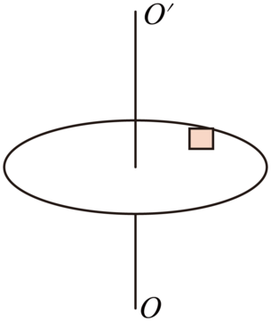

# Physics - 题目 1711

**ID**: 42fa17f59d2a407e85ebf7b25f00e84a
**年级**: Grade 10
**难度**: Medium
**题型**: Multiple-select

## 题目
如图所示，水平圆台可绕过其圆心的竖直轴OO′转动，可视为质点、质量为1 kg的物块放在距圆心L＝0.3 m处，物块与台面间的动摩擦因数为0.27。​​​​​​​‌圆台绕竖直轴转动的角速度由0开始随时间均匀增大，角速度与时间的关系式为ω＝kt，其中 $k=1{\rm{r}}{\rm{a}}{\rm{d}}{\rm{/}}{\rm{s}}{^{2}}$ ，物块随圆台一起做圆周运动物块与台面间的摩擦力恰好达到最大静摩擦力的时刻为 $t{{}_{0}}$ （未知）。接触面间的最大静摩擦力等于滑动摩擦力，取重力加速度大小 $g=10{\rm{m}}{\rm{/}}{\rm{s}}{^{2}}$ 。下列说法正确的是（      ）

## 解答

1. A．物块随圆台一起做圆周运动时，由于其角速度随时间均匀增大，圆台对物块的摩擦力可分解为指向圆心方向的分力 $f{{}_{1}}$ 和沿圆周轨迹切线方向的分力 $f{{}_{2}}$ ，因此物块受到的摩擦力方向并未指向圆心，A正确；
2. B．物块的线速度大小随时间均匀变化，其轨迹切线方向的加速度大小 $a{{}_{2}}=\frac {{\rm{Δ}}ω}{{\rm{Δ}}t}L=kL$ ，向心加速度大小 $a{{}_{1}}=ω{^{2}}L=k{^{2}}t{^{2}}L$ ，由牛顿第二定律有 $f{{}_{1}}=ma{{}_{1}}$ ， $f{{}_{2}}=ma{{}_{2}}$ ，物块与台面间的摩擦力达到最大静摩擦力时有 $f=\sqrt {f{{}_{1}}{^{2}}+f{{}_{2}}{^{2}}}={\rm μm}g$ ，解得 $t{{}_{0}}=2\sqrt[4]{5}{\rm{s}}<3{\rm{s}}{\rm ，B}$ 错误；
3. ${\rm CD．}t{{}_{0}}$ 时刻物块的线速度大小 $v=ωL=kt{{}_{0}}L=\frac {3\sqrt[4]{5}}{5}{\rm{m}}/{\rm{s}}$ ，物块增加的机械能 ${\rm{Δ}}E=\frac {1}{2}mv{^{2}}=\frac {9\sqrt {5}}{50}{\rm{J}}$ ，根据动能定理可知摩擦力对物块做的功为 $\frac {9\sqrt {5}}{50}{\rm{J}}{\rm ，C}$ 错误，D正确。选AD。

## 知识点

**中文**:
  - 水平面内匀速圆周问题

**English**:
  - Uniform Circular Motion in Horizontal Plane

---
