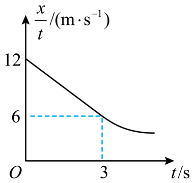

# Physics - 题目 1576

**ID**: 6b6602ab355a4eb9b1aec119d56c3483
**年级**: Grade 10
**难度**: Medium
**题型**: Multiple-select

## 题目
物块在粗糙水平面上做匀减速直线运动直到停止。​​​​​​​‌在这一过程中，手机软件描绘出其位移x和时间t的比值， $\frac {x}{t}$ 与t间的关系如图所示。已知0~3s内图像为直线，3s后图像为反比例曲线。下列说法正确的是（      ）

## 解答

1. 根据匀减速直线运动的位移-时间公式有 $x=v{{}_{0}}t-\frac {1}{2}at{^{2}}$ ，解得 $\frac {x}{t}=v{{}_{0}}-\frac {1}{2}at$ ，根据0~3s内图像为直线，则可得 $v{{}_{0}}=12{\rm{m}}/{\rm{s}}$ ， $\frac {1}{2}a=\frac {12-6}{3}$ ，可得 $a=4{\rm{m}}/{\rm{s}}{^{2}}$ ，故BC正确；设物块减速到零的时间为 $t{{}_{0}}$ ，则有 $t{{}_{0}}=\frac {v{{}_{0}}}{a}=3{\rm{s}}$ ，说明物块经3s速度减为零，不再移动，故A错误；物块滑行的距离为 $x=\frac {v{{}_{0}}}{2}t{{}_{0}}=\frac {12}{2}\times 3{\rm{m}}=18{\rm{m}}$ ，故D错误。

## 知识点

**中文**:
  - 匀变速直线运动的位移—时间公式及其应用
  - 非常规图像问题

**English**:
  - Displacement-Time Formula and Applications
  - Non-standard Graph Problems

---
