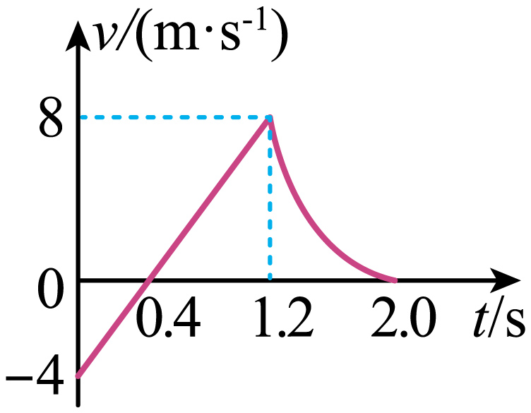

# Physics - 题目 795

**ID**: 6eb85e688c6546cead4af6a34e128470
**年级**: Grade 10
**难度**: Medium
**题型**: Multiple-select

## 题目
中国跳水“梦之队”在东京奥运会上荣获7金5银12枚奖牌。​​​​​​​‌某同学将一小球（可看成质点）从平台边缘竖直向上抛出来模拟运动员的跳水运动，从小球抛出时开始计时，若小球的速度与时间关系的图像如图所示，不计空气阻力，则下列说法正确的是（      ）

## 解答

1. 小球从平台边缘竖直向上抛出，在0-0.4s时间内小球上升，0.4s-2.0s时间内小球下降，不计空气阻力，小球在空中运动时加速度不变，则小球在0.4s时达到最高点，1.2s小球开始进入水面，A错误；1.2s至2.0s时间内进入水中做减速运动，2.0s到水中最深处，加速度为0，B错误；由图可知小球上升时间为 $t{{}_{1}}=0.4{\rm s}$ ，上升的高度 $h{{}_{1}}=\frac {v{{}_{0}}}{2}t{{}_{1}}=\frac {4}{2}\times 0.4{\rm m}=0.8{\rm m}{\rm ，0.4-1.2s}$ 小球自由下落的高度为 $h{{}_{2}}=\frac {v{{}_{1}}}{2}t{{}_{2}}=\frac {8}{2}\times 0.8{\rm m}=3.2{\rm m}$ ，因此跳台与水面的高度差为 $h=h{{}_{2}}-h{{}_{1}}=3.2{\rm m}-0.8{\rm m}=2.4{\rm m}{\rm ，C}$ 正确；若小球潜入水中做匀减速运动，则通过的位移为 $h{{}_{3}}=\frac {v{{}_{1}}}{2}t{{}_{2}}=\frac {8}{2}\times 0.8{\rm m}=3.2{\rm m}$ ，而实际上，小球做加速度减小的减速运动，相同时间位移较小，小球潜入水中的深度小于3.2m，D正确。

## 知识点

**中文**:
  - v-t图像及其应用

**English**:
  - v-t Graphs and Applications

---
