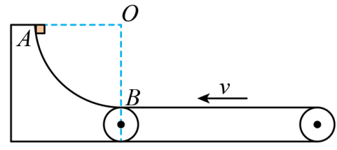

# Physics - 题目 2097

**ID**: 7b01777022b1437f827a128da0da0d33
**年级**: Grade 10
**难度**: Medium
**题型**: Multiple-select

## 题目
如图所示，一固定的四分之一光滑圆弧轨道与逆时针匀速传动的水平足够长的传送带平滑连接于B点，圆弧轨道半径为R。​​​​​​​‌质量为m的小滑块自圆弧轨道最高点A以某一初速度 $v{{}_{0}}$ 沿切线进入圆弧轨道，小滑块在传送带上运动一段时间后返回圆弧轨道。已知重力加速度为g，滑块与传送带之间的滑动摩擦因数为 $μ$ ，传送带速度大小为 $v=\sqrt {gR}$ 。不计空气阻力，则以下说法正确的是（      ）

## 解答

1. A．由于传送带足够长，小滑块每次减速到0，都会反向加速到一定的速度，所以小滑块在圆弧和传送带之间做往返运动，最终不会停在B点。A错误；
2. B．由于小滑块返回来的速度最大与传送带共速，则 $-mgh{{}_{{\rm{m}}}}=0-\frac {1}{2}mv{^{2}}$ ，解得 $h{{}_{{\rm{m}}}}=\frac {R}{2}{\rm ，B}$ 正确；
3. C．设小滑块第1次过B点速度大小为 $v{{}_{1}}$ ，则 $mgR=\frac {1}{2}mv{{}_{1}^{2}}-\frac {1}{2}mv{{}_{0}^{2}}$ ，解得 $v{{}_{1}}=2\sqrt {gR}$ 。小滑块滑上传送带到共速，设小滑块位移为 $x{{}_{1}}$ ，传送带位移为 $x{{}_{2}}$ ，规定向左为正，则 ${\rm μm}g=ma$ ，
4. $v=-v{{}_{1}}+at$ ， $x{{}_{1}}=\frac {v-v{{}_{1}}}{2}t$ ， $x{{}_{2}}=vt$ ，联立解得 $a=μg，t=\frac {3\sqrt {gR}}{μg}，x{{}_{1}}=-\frac {3R}{2μ}，x{{}_{2}}=\frac {3R}{μ}$ 。分析可知，滑痕为它们的相对位移，即 $s=x{{}_{2}}-x{{}_{1}}=\frac {9R}{2μ}{\rm ，C}$ 错误；
5. D．小滑块到B点的速度大小设为 $v^{′}$ ，则 $mgR=\frac {1}{2}mv^{′}{{^{2}}}-0$ ，解得 $v^{′}=\sqrt {2gR}>v$ 。可知，小滑块过B点后，先减速到0，再反向加速到与传送带共速，最后匀速到达B点，之后以这个速度在圆弧和传送带之间做往返运动。因此小滑块第五次在传送带上运动的整个过程的时间是 $t=2\frac {v}{a}=\frac {2}{μ}\sqrt {\frac {R}{g}}{\rm ，D}$ 正确。选BD。

## 知识点

**中文**:
  - 传送带模型中的能量守恒问题

**English**:
  - Energy Conservation in Conveyor Belt Models

---
