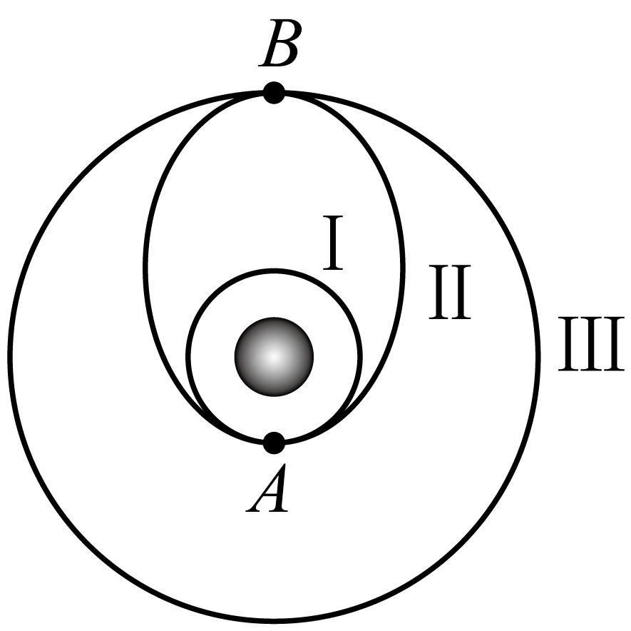

# Physics - 题目 2969

**ID**: 889cf0810d7d47ea98d493cdf317c961
**年级**: Grade 10
**难度**: Medium
**题型**: Multiple-select

## 题目
2025年3月26日，我国成功将地球同步轨道数据中继卫星“天链二号04星”发射升空，人造卫星的发射过程要经过多次变轨方可到达预定轨道。​​​​​​​‌假设图示三个轨道均是“天链二号04星”绕地球飞行的轨道，其中轨道Ⅰ、Ⅲ均为圆形轨道，轨道Ⅱ为椭圆形轨道，三个轨道在同一平面内，轨道Ⅱ与轨道Ⅰ相切于A点，与轨道Ⅲ相切于B点，不计该卫星在变轨过程中的质量变化。关于该卫星下列说法正确的是（      ）

## 解答

1. 因卫星在轨道Ⅰ的运行半径小于在轨道Ⅲ的运行半径，根据开普勒第三定律 $\frac {r{^{3}}}{T{^{2}}}=k$ 可知，在轨道Ⅰ的运行周期小于在轨道Ⅲ的运行周期，选项A错误；在B点瞬间加速做离心运动才能使运行轨道由Ⅱ变为Ⅲ，选项B正确；沿椭圆轨道Ⅱ从A点飞向B点过程中只有地球引力做功，则机械能守恒，选项C正确；根据 $G\frac {Mm}{r{^{2}}}=ma$ 可知，在轨道Ⅰ经过A点的加速度等于在轨道Ⅱ经过A点的加速度，选项D错误。

## 知识点

**中文**:
  - 卫星变轨与对接问题
  - 开普勒三大定律及其应用

**English**:
  - Satellite Orbit Change and Docking
  - Kepler's Three Laws and Applications

---
