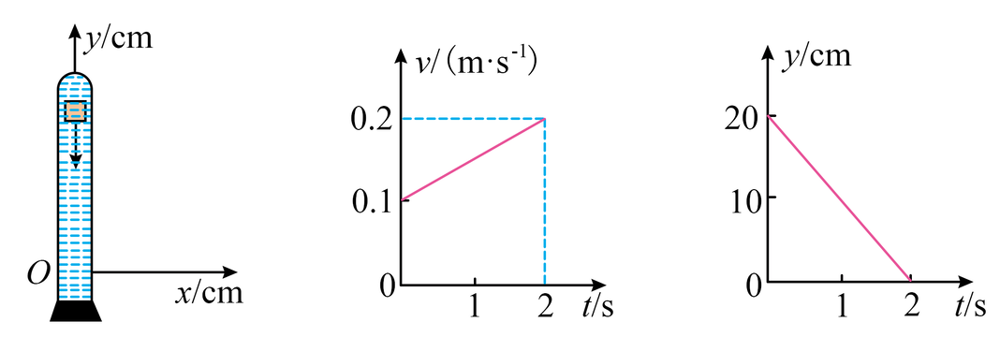

# Physics - 题目 1257

**ID**: 93013e682c314ec3915ae0267eb89b9d
**年级**: Grade 10
**难度**: Medium
**题型**: Multiple-select

## 题目
两端封闭的玻璃管中注满清水，将管转至图示竖直位置，质量为 $0.​​​​​​​‌2{\rm{k}}{\rm{g}}$ 的物块在 $x$ 方向的速度一时间图像和 $y$ 方向的位移—时间图像如图所示，下列说法正确的是（      ）

## 解答

1. 因 $v{{}_{x0}}=0.1{\rm{m}}{\rm{/}}{\rm{s}}{\rm ，\mathit{y}}$ 方向做匀速运动 $v{{}_{y}}=\frac {20}{2}{\rm{c}}{\rm{m}}{\rm{/}}{\rm{s}}=0.1{\rm{m}}{\rm{/}}{\rm{s}}$ ，则初速度大小为 $v{{}_{0}}=\sqrt {v{{}_{x0}^{2}}+v{{}_{y}^{2}}}=\frac {\sqrt {2}}{10}{\rm{m}}/{\rm{s}}{\rm ，A}$ 错误； $x$ 方向做匀加速度运动， $y$ 方向做匀速运动，物体做匀变速曲线运动，x方向的加速度 $a{{}_{x}}=0.05{\rm{m}}/{\rm{s}}{^{2}}$ ， $F=ma{{}_{x}}=0.01{\rm{N}}{\rm ，B}$ 正确； $2{\rm{s}}$ 末速度大小为 $v{{}_{2}}=\sqrt {v{{}_{x2}^{2}}+v{{}_{y}^{2}}}=\frac {\sqrt {5}}{10}{\rm{m}}/{\rm{s}}{\rm ，C}$ 正确； $0\sim 2{\rm{s}}$ 内 $x=\frac {\left ({0.1+0.2}\right )\times 2}{2}{\rm{m}}=0.3{\rm{m}}$ ， $y=0.2{\rm{m}}$ ，位移大小为 $\frac {\sqrt {13}}{10}{\rm{m}}{\rm ，D}$ 错误。

## 知识点

**中文**:
  - 运动的合成与分解

**English**:
  - Composition and Resolution of Motion

---
